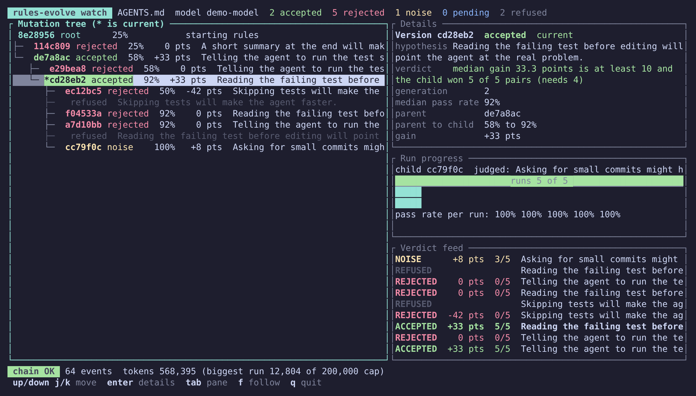

# rules-evolve (working name)

A small command line tool that helps you improve your repo's agent rules file
(`AGENTS.md`, `CLAUDE.md`, or a file in `.cursor/rules`) with measurements
instead of gut feeling.

The idea:

- The model stays fixed. Only the rules file changes.
- Each change is a small mutation of its parent version, with a plain-English
  hypothesis ("tell the agent to run the tests first").
- Each version is benchmarked on tasks taken from your own repo, several times,
  and the median is used.
- A change is kept only if it clearly beats its parent. Otherwise it is
  rejected or marked as noise.
- Every attempt, including failures and refused changes, is written to an
  append-only, hash-chained log. The lineage tree is rebuilt from that log.

It is bring your own key and runs locally. Nothing is uploaded anywhere.

## Inspiration

This project is inspired by [Petri](https://ethglobal.com/showcase/petri-mjy1y)
(ETHOnline 2026). Petri is the inspiration only. The angle here is different:
a local tool that evolves a repo's rules file against that repo's own tasks.

## Status: v1.1

No real model is ever called yet. Everything runs on a deterministic **mock
model**, so nothing here costs money or touches the network.

Done in Phase 1:

- Cargo workspace: `crates/core` (engine library) and `crates/cli` (the
  `rules-evolve` binary).
- Append-only, hash-chained log with tamper and truncation checks.
- Tree rebuilt from the log. Rules file versions are stored by content hash.
- Commands: `init`, `status`, `log`, `verify-log`.

Done in Phase 2 (the benchmark harness):

- A `Model` trait (the provider abstraction) and a seedable `MockModel`.
- `tasks.toml` parsing: id, prompt, shell check, optional timeout.
- A sandboxed worktree per attempt that keeps benchmark files away from the
  model (threat model and limits below).
- `run`: runs a rules version `repeats` times over the task set, records every
  run, and enforces the token cap.
- `verify`: compares a child to its parent with the fixed public rule and
  records a verdict.
- `propose`: a temporary way to add a child version from a file, so `run` and
  `verify` can be used before the real `mutate` exists.

Done in Phase 3 (model driven mutation and replay):

- `mutate`: asks the model for one small rules change plus a hypothesis, checks
  it, and records `mutation_proposed` or `mutation_refused`.
- `evolve --generations N`: loops mutate, run, verify, and moves `current`
  forward only when a child is accepted.
- Recording and replay: any provider can record every request and response into
  a replay file. The `replay` provider answers from that file with zero cost and
  fails clearly when it has no answer.
- A committed demo in `examples/demo/` that runs a full lineage with no key.

Done in Phase 4 (digest, export and the static viewer):

- `digest`: a plain English brief of the lineage: what worked, what failed
  (rejected and refused, with reasons), what is noise, what is pending, and
  directions not tried yet. Markdown or `--json`. No model is called.
- `export --out tree.json`: the whole lineage as one JSON file, described by
  the versioned schema in `schema/export.v1.json` and validated against it in
  tests.
- A static viewer in `viewer/` (Vite, TypeScript, Svelte, Cytoscape.js, Observable
  Plot, diff2html) that opens that file. The build is one `index.html` that works
  from disk with no server, no key and no network.

Done in v1.1 (the optional `watch` terminal view):

- `watch`: a live ratatui view that follows the log while another process runs
  `evolve`. It is read only, lives in its own crate (`crates/watch`), and the
  core crate has no terminal dependencies. See "Watch" below.
- `--pace MS` for the replay provider, so a replayed demo plays at a watchable
  speed.

Planned later (not built yet): real bring-your-own-key providers and a Claude
Code plugin. See the roadmap below.

## Roadmap and required TODO

**TODO, required before any real provider is enabled: run the sandbox in a
container or with other operating system isolation.** The current sandbox only
keeps the model from reading the benchmark files through the folder it is
given. It is not an operating system sandbox (see "Sandbox and threat model"
below for the exact limits). Mock and replay providers read nothing, so they are
safe today. A real provider that can run code or tools must not be switched on
until checks and model tools run inside a container, a separate user, or an
equivalent boundary. No network provider exists in the code yet, and none should
be added before this is done.

Other planned work: a Claude Code plugin and the real bring-your-own-key
providers.

## Not doing

- No paste-your-API-key website. Keys stay on your machine.
- No claim about evolving model weights. The model never changes. Only the
  rules text evolves.

## Build and test

```
cargo build
cargo test
cargo clippy --all-targets -- -D warnings
cargo fmt --check
```

The binary is `target/debug/rules-evolve`. The viewer has its own checks, see
"Viewer" below.

The `watch` command is behind the cargo feature `watch`, which is on by default.
To build a binary without any terminal code, run
`cargo build -p rules-evolve-cli --no-default-features`.

## Commands

Global options: `--json` (machine readable output) and `-C, --dir <DIR>` (repo
root, default `.`).

### `init --model <NAME> [--rules-file <PATH>]`

Creates `.rules-evolve/` in the repo. If `--rules-file` is not given, it looks
for `AGENTS.md`, then `CLAUDE.md`, then `.cursor/rules` and uses the first one
it finds. A `.cursor/rules` folder is used only if it holds exactly one file,
since one file is evolved at a time. The model name is only recorded. No model
is called.

It writes:

| Path | What it is |
| --- | --- |
| `.rules-evolve/config.toml` | Settings (see below) |
| `.rules-evolve/tasks.toml` | Task template: each task is a prompt plus a shell check |
| `.rules-evolve/.gitignore` | Ignores only `scratch/` and `sandbox/` folders, nothing else |
| `.rules-evolve/log.jsonl` | The lineage log, starting with an `init` event |
| `.rules-evolve/HEAD` | Newest `seq` and `hash`, used to spot cut off logs |
| `.rules-evolve/blobs/<sha256>` | Rules file versions, named by content hash |

**Commit `.rules-evolve/` in your repo.** The log, `HEAD`, blobs, config and
tasks are all meant to live in git, so the lineage has history that the tool
itself cannot rewrite. `init` checks with `git check-ignore` that git does not
ignore the folder. If one of your ignore rules does, `init` appends
`!.rules-evolve/` to the repo's `.gitignore` and checks again. The result is in
the `gitignore` field of the JSON output (`status` is `ok`, `fixed`,
`still_ignored`, `not_a_git_repo`, or `git_unavailable`). The only ignore file
the tool writes inside the folder covers `scratch/` and `sandbox/`.

Default settings (confirmed by the project owner, and recorded in `config.toml`
as `defaults_confirmed = true`):

| Setting | Default | Meaning |
| --- | --- | --- |
| `repeats` | 5 | Runs per version, median taken |
| `accept_threshold_pp` | 10 | Child must beat parent by 10 percentage points of median pass rate |
| `min_paired_wins` | 4 | And win at least 4 of the 5 paired runs, otherwise it is noise |
| `max_tokens_per_run` | 200000 | Token cap for one run |
| `max_change_bytes` | 1000 | Largest allowed change for `propose` (under `[mutation]`) |

A task in `tasks.toml` looks like this. The check command exits with 0 to pass.

```toml
[[task]]
id = "example-fix-failing-test"
prompt = "The test suite has one failing test. Fix the code so all tests pass."
check = "cargo test --quiet"
```

### `status`

Shows whether the log is intact, the settings, and a summary of the tree:
versions, mutations (accepted, rejected, noise, pending), refused mutations,
recorded runs, and each edge with its hypothesis and verdict. If the log fails
verification, the tree is not shown.

### `log [--limit N] [--kind KIND]`

Lists events in order. `--limit N` shows the newest N. `--kind` is one of
`init`, `mutation_proposed`, `mutation_refused`, `run_recorded`, `verdict`.

### `verify-log`

Checks the hash chain, the `HEAD` file, and that every stored rules file
matches its hash.

### `propose --file <PATH> --hypothesis <TEXT> [--parent <VERSION>]`

Temporary. Adds a child rules version from a file holding the full new text.
`--parent` is `root`, `current` (default), a full hash, or a hash prefix of at
least 4 characters. The engine stores the text by hash and writes a
`mutation_proposed` event. It is replaced by the model driven `mutate` in
Phase 3.
For a model written change use `mutate` instead.

There is a size limit: the changed part (what is cut out or put in, after
trimming the shared start and end) may not be larger than
`[mutation] max_change_bytes` in `config.toml` (default 1000 bytes). Too big,
identical to the parent, or already in the tree: nothing is added, a
`mutation_refused` event is written, and the exit code is 3. The hypothesis
must not be empty, and the file must be UTF-8 text.

### `run [--version V] [--repeats N] [--seed S] [provider options]`

Runs one rules version over the whole task set `repeats` times (default from
`config.toml`, 5) and writes one `run_recorded` event per run, with the pass
rate (`passed` and `total`), tokens used, and the seed. `--version` is `root`,
`current` (default), or a hash or prefix, so you run the parent and the child
the same way.

- Run `i` uses the seed derived from `--seed` and `i`. Use the same `--seed`
  for parent and child so that run `i` of each is paired. The default is 0.
- Runs already in the log are skipped, so you can stop and start again, or ask
  for more repeats. A different `--seed` for an already recorded run is an
  error.
- **Token cap.** Each run (one pass over all tasks) may use at most
  `max_tokens_per_run`. Before each model call the harness asks the provider
  for a token estimate and does not make the call if it would go over the cap.
  The rest of the tasks in that run are marked `skipped_budget` and count as
  failed, and the run is recorded with `budget_exhausted: true`. If a provider
  ever reports more tokens than were left, its answer is thrown away
  (`over_budget`) and the run stops with `tokens_used` set to the cap. The
  recorded tokens for a run never go over the cap.
- Provider options are shared with `mutate` and `evolve` (see "Providers,
  recording and replay"). Only `mock` and `replay` exist. Any other name is an
  error.

### `mutate [--parent V] [--seed S] [provider options]`

Asks the model for one small change to a rules version (default `current`) and a
plain English hypothesis, then validates and records the answer.

The mutation prompt is built from three things: the rules text being changed,
the history of the lineage (what was accepted, rejected, noise, pending and
refused, with the hypothesis for each and the median change for judged ones,
oldest first, at most the latest 40 lines), and the size limit. The same tree
always gives the same prompt text.

Checks on the answer, using the same rules as `propose`. Any failure writes a
`mutation_refused` event, nothing is added to the tree, and the exit code is 3:

- the hypothesis is empty;
- the new rules text is empty;
- the new text is identical to the parent;
- the new text already exists as a version in the tree;
- the change is larger than `[mutation] max_change_bytes` (1000 bytes);
- the model reports more tokens than `max_tokens_per_run`, or a call would be
  estimated to go over it. The model's answer is then thrown away.

A valid answer writes `mutation_proposed`. Both events also record the
`seed`, `provider` and `tokens_used` of the call. If the model itself fails
(including a replay miss) the error is returned and nothing is written.

`--seed` is passed to the model as is. The same seed, tree and provider give
the same mutation.

### `evolve --generations N [--seed S] [provider options]`

Runs `N` generations (1 to 100). Each generation:

1. `mutate` from `current`, with a mutation seed derived from `--seed` and the
   number of earlier attempts in the tree;
2. if the mutation was recorded, `run` the parent and the child (runs already
   in the log are reused) with `--seed` as the run seed;
3. `verify` the child with the fixed rule.

`current` moves to the child only on `accepted`. Rejected, noise and refused
generations leave it where it was, so later generations keep building on the
best version so far. The same `--seed`, settings and provider give the same
lineage, so you can also continue a lineage by running `evolve` again. The
report lists each generation with its mutation, verdict, and `current`.

### `verify --child V`

Compares the child to its parent with the fixed rule below and writes a
`verdict` event. Both versions need runs `0..repeats` recorded with matching
seeds and task counts, otherwise it tells you what to run first. A child gets
one verdict.

### `digest`

Prints a brief of the lineage as Markdown, or as JSON with `--json` (the digest
is the `data` field). It reads the log, so it refuses to run when the hash chain
fails verification. Sections:

- **What worked**: accepted changes, with the hypothesis, the gain in points, the
  paired wins, and the median pass rate before and after.
- **What failed**: rejected changes with the verdict reason, and refused
  mutations with the reason they were refused.
- **Noise**: changes that gained a little but not clearly.
- **Pending**: versions that have no verdict yet.
- **Directions not tried yet**: suggestions.

The suggestions are deterministic and come from fixed rules, not a model: run
the pending changes, retest noisy gains with more repeats, retry a smaller
version of a change refused for size, build on the latest win, explore or avoid
the words that only show up in accepted or only in rejected hypotheses, widen
the proposals when several were refused as repeats, and finally name common
rules file topics (testing, reading before editing, small changes, checking its
own work, edge cases, asking when unsure, style, commits, docs, tools, planning)
that no hypothesis has mentioned yet. The word themes are a simple keyword
heuristic and are only a hint. The same lineage always gives the same digest.

A sample from the demo (the full file is `examples/demo/digest.md`):

```
# Rules lineage digest

Rules file: `AGENTS.md`. Model: `demo-model`.

9 versions and 8 mutations tried: 2 accepted, 5 rejected, 1 noise, 0 pending. 2 refused before they became versions.

Current version: `cd28eb296938` (root `8e28956afd69`). Median pass rate moved from 25% to 92% (+66.7 points).

## What worked

- **Telling the agent to run the test suite before it finishes will catch more mistakes** (`de7a8ac7ef75`, +33.3 points, 5 of 5 paired wins). Median pass rate 25% to 58%.
- **Reading the failing test before editing will point the agent at the real problem** (`cd28eb296938`, +33.3 points, 5 of 5 paired wins). Median pass rate 58% to 92%.

## What failed

### Rejected

- Skipping tests will make the agent faster (`ec12bc56d472`, -41.7 points). child median 0.500 is not above parent median 0.917
...
```

### `export --out <PATH>`

Writes the lineage as one JSON file for the viewer. `--out -` prints it to
standard output instead (with `--json` it becomes the `data` field). The export
is only written when the log verifies. It holds every version with its full text
and its diff from the parent, every edge with its hypothesis, verdict, reason,
medians, gain and run pairs, every refused mutation, per attempt series for the
charts, the thresholds from the config, and the hash chain head at export time.
It has no timestamps and no file paths, so the same log always exports to the
same bytes.

The format is described by [`schema/export.v1.json`](schema/export.v1.json)
(JSON Schema draft 2020-12). Tests validate real exports against it, and the
viewer validates every file it opens against the same schema. Version 1 never
removes or renames a field. A change to the shape means a new version number
and a new schema file.

### Exit codes

| Code | Meaning |
| --- | --- |
| 0 | Success |
| 1 | Error (not initialized, bad arguments, broken log for `log`, and so on) |
| 2 | `status` or `verify-log` ran, but verification failed |
| 3 | `propose` ran, but the change was refused and logged |

## Tasks

`.rules-evolve/tasks.toml` holds the benchmark tasks and the sandbox settings.

```toml
[sandbox]
hidden = ["tests", "check.sh", "**/*_test.go"]   # benchmark files, see below
exclude = ["target", "node_modules"]             # never copied (the default)
env_passthrough = []                              # variables check commands may see
default_timeout_secs = 60

[[task]]
id = "fix-parser-bug"          # letters, digits, _ - . only, unique
prompt = "The date parser fails on leap days. Fix it."
check = "sh tests/run.sh fix-parser-bug"   # exit 0 means pass
timeout_secs = 120             # optional, overrides default_timeout_secs
```

Unknown keys are errors, so typos do not pass silently. Paths in `hidden` and
`exclude` are relative to the repo root. A path covers everything under it. `*`
matches inside one folder level, `**` matches any number of levels, `?` matches
one character.

## Providers, recording and replay

A provider is anything that implements the `Model` trait in `crates/core`: it
answers tasks and proposes mutations, and reports an estimate of its token use.
The harness uses nothing else, so real bring-your-own-key providers can be added
later without changing it. **No provider uses the network today.**

Options shared by `run`, `mutate` and `evolve`:

| Option | Meaning |
| --- | --- |
| `--provider mock\|replay` | Which provider to use (default `mock`) |
| `--mock-config PATH` | Mock settings (default `.rules-evolve/mock.toml`) |
| `--replay-file PATH` | Replay file to answer from (for `--provider replay`) |
| `--record PATH` | Record every model request and response into this file |

**Recording.** `--record` works with any provider that makes calls (the mock now,
real providers later). Each call is stored in a replay file, which is JSON Lines.
The first line is a header naming the provider. Every other line is one call:

```json
{"type":"header","format":1,"provider":"mock"}
{"type":"entry","key":"3f9a...","kind":"task","model":"demo-model","task_id":"task-01","seed":123,"rules_hash":"8e28...","prompt_sha256":"b1c2...","response":{"edits":[{"path":"answers/task-01.txt","content":"ok\n"}],"tokens_used":1008}}
```

The `key` is the SHA-256 of the canonical JSON of `{kind, model, prompt_sha256,
provider, rules_hash, seed, task_id}`. So the same provider, model name, prompt,
rules version, task and seed always find the same answer, and a change to any of
them is a miss. For a mutation call, `kind` is `mutation`, the prompt is the
mutation prompt, `rules_hash` is the parent version, and `task_id` is empty.
Recording appends to an existing file of the same provider and skips calls it
already has. A file from another provider is refused.

**Replay.** `--provider replay --replay-file PATH` answers only from the file.
It never calls anything, so it costs nothing. The recorded token counts are
served too, so the token cap behaves exactly as it did when recording, and a
replayed run gives the same pass rates, tokens, hypotheses, hashes and verdicts
as the recorded one (only timestamps and the `provider` field in the log differ,
which says `replay`). If the file has no answer for a request, the command stops
with a `replay miss` error that names the task, rules version and seed, and
nothing from that run is written. Record the file again with `--record` if you change the model
name, tasks, prompts, rules or seeds.

## Demo (no key, no cost)

`examples/demo/` holds a small fixture repo, its tasks, mock settings, and a
committed replay file recorded from the mock model. Run a ten generation lineage
with accepted, rejected, noise and refused outcomes:

```
cargo build
examples/demo/demo.sh
```

It copies the fixture to a temp folder, runs `init`, and then:

```
rules-evolve -C <folder> evolve --generations 10 --seed 7 \
    --provider replay --replay-file examples/demo/replay.jsonl
rules-evolve -C <folder> status
rules-evolve -C <folder> verify-log
```

Expected result: 2 accepted, 5 rejected, 1 noise, 2 refused, ending two accepted
versions past the start. The replay file only holds the calls the demo made, so
a different `--seed` or generation count reports a replay miss, which is the
intended behavior. To try record and replay on a single step yourself:

```
rules-evolve -C <folder> mutate --seed 1 --record my-replay.jsonl
rules-evolve -C <copy of the same folder before that step> mutate --seed 1 \
    --provider replay --replay-file my-replay.jsonl --json
```

To record the demo again from the mock model, for example after changing
`mock.toml`, run `examples/demo/demo.sh --record` and commit the new
`replay.jsonl`. A test checks that the committed file matches a fresh recording.

## Watch

`rules-evolve watch [-C dir]` is a live terminal view of
`.rules-evolve/log.jsonl`. Leave it open in one terminal and run `evolve` in
another: the view polls the log (every 200 ms, change with `--interval`) and
redraws as events arrive. It never writes to the log.

```
rules-evolve watch                  # follow the repo in the current folder
rules-evolve watch --run "evolve --generations 3 --provider replay --replay-file r.jsonl"
```

Panes:

- **Mutation tree**: indented lineage, colored by verdict (green accepted, red
  rejected, yellow noise, grey pending), with `*` on the current version and
  refused attempts dimmed under their parent.
- **Details**: the selected version: hypothesis, verdict reason, medians, parent
  to child pass rate and gain. Press `enter` for a full screen overlay with
  the rules diff against the parent (`esc`, `enter` or `q` closes it).
- **Run progress**: for the version being benchmarked, runs done out of repeats,
  a gauge, and a sparkline of the pass rate per run.
- **Verdict feed**: newest first, one line per finished verify or refusal, with
  hypothesis, gain, paired wins and verdict.
- **Status bar**: chain validity, event count, token totals (biggest run against
  the cap), the child process if any, and key help.

Keys: `up`/`down` or `j`/`k` move, `enter` opens or closes the details overlay, `tab` moves
between panes, `f` toggles following the newest node, `q` quits (press it twice
while a `--run` child is still going, which also stops the child).

If the hash chain fails verification the view shows a red banner with the reason
and stays read only, still drawing the part of the log that verified. A reader
can catch a writer between appending an event and updating `HEAD`, so the alarm
only appears after three bad reads in a row. Tampering is reported, never
repaired.

`--run "<command>"` starts one of `evolve`, `run`, `mutate`, `verify` or
`propose` as a child process on the same repo and shows it live. The command
text is split on spaces with simple quoting, runs without a shell, and may not
contain `-C` (the repo is the one being watched).

Replay demo with no key and no cost:

```
examples/demo/watch.sh        # 30 ms of simulated latency per model call
examples/demo/watch.sh 100    # slower
```

`--pace MS` (replay provider only) sleeps before each replayed answer. It does
not change any result or the log contents, only how fast they arrive.

For scripts, docs and tests there is a mode that needs no terminal:

```
rules-evolve watch --snapshot --width 130 --height 34 --select current
rules-evolve watch --snapshot --svg out.svg
```

`--snapshot` prints one frame as text (or as JSON with `--json`). `--svg` writes
the same frame with colors as an SVG. `--select` takes `current`, `root` or a
version hash prefix. The finished demo is committed as
[`docs/screenshots/watch-demo.txt`](docs/screenshots/watch-demo.txt),
[`.svg`](docs/screenshots/watch-demo.svg) and
[`.png`](docs/screenshots/watch-demo.png), regenerated by
`examples/demo/watch-snapshot.sh`. A test fails if the text or SVG goes stale.



The crate is layered so rendering stays thin: `state` (events to tree, progress
and feed, pure), `view` (selection, focus and keys), `ui` (drawing, tested with
ratatui's `TestBackend` against golden text in `crates/watch/snapshots/`), and
`app` (terminal loop, tailing, child process). Refresh goldens with
`UPDATE_SNAPSHOTS=1 cargo test -p rules-evolve-watch`.

## Viewer

`viewer/` is a static, local web page for exported lineages. It draws the tree
top down, colored by verdict (green accepted, red rejected, amber noise, grey
pending, dashed grey refused), with edge labels such as "pass rate +33 pts".
Click a version to see its hypothesis, the verdict reason, the run pairs, and
the diff from its parent. Charts show the pass rate attempt by attempt, the gain
of each attempt against the accept threshold, and the spread of every run so you
can see how noisy the benchmark is. It has a light and a dark theme.


It runs entirely in the browser. It has no analytics, loads nothing from a CDN,
and makes no network request: the build is one `index.html` with the scripts and
styles inlined, so it opens straight from disk. The demo lineage is bundled in.

Open it locally (needs Node 20 or newer, one time install):

```
cd viewer
npm install
npm run build
```

Then open `viewer/dist/index.html` in a browser. To see your own lineage:

```
rules-evolve export --out tree.json
```

and either click **Open tree.json**, drag the file onto the page, or serve
`dist/` over http and add `?tree=tree.json` to the address (fetching by URL does
not work from `file://`, that is a browser rule). A file that is not an export,
is cut off, is from a newer format, or does not match the schema shows a plain
explanation and leaves the lineage that was already open in place. The address
`#v=<hash prefix>` selects a version.

Regenerate the bundled demo export from `examples/demo` (replays the committed
answers, no key, no cost), then rebuild:

```
examples/demo/export.sh        # or: cd viewer && npm run demo
cd viewer && npm run build
```

`export.sh` rewrites `examples/demo/tree.json`, `examples/demo/digest.md`, and
the copy at `viewer/src/demo/tree.json`. A Rust test fails if those drift from a
fresh replay.

Viewer checks (from `viewer/`):

```
npm test            # vitest: parsing, validation, formatting, graph model
npm run check       # svelte-check and TypeScript
npm run build       # dist/index.html
npm run smoke       # Chrome: loads, bad file, drag and drop, no network
npm run screenshots # rewrites docs/screenshots (needs an installed Chrome)
```

The smoke test and the screenshots use `playwright-core` with a Chrome or
Chromium that is already installed (set `CHROME_PATH` if it is not in a usual
place). Nothing is downloaded.

## Mock model

`run`, `mutate` and `evolve` with `--provider mock` read
`.rules-evolve/mock.toml` (or `--mock-config`). Everything is
deterministic: the same settings and seed give the same answers on any machine.

```toml
seed = 7                      # mixed into every draw
base_pass_probability = 0.3   # chance of a right answer with no marker
independent_noise = 0.0       # 0 to 1, see below
tokens_per_call = 1000        # plus (prompt + rules characters) / 4

[[marker]]                    # if this text is in the rules, add delta
text = "run the tests first"
delta = 0.4

[[answer]]                    # what a right and a wrong answer look like
task = "fix-parser-bug"
path = "answers/fix-parser-bug.txt"
pass_content = "ok\n"
fail_content = "no\n"

[[mutation]]                  # a change `mutate` can propose
hypothesis = "Running tests first catches mistakes."
append = "Run the tests first."     # add a line at the end of the rules
# or swap text instead:  find = "old text"   replace_with = "new text"
```

For each task attempt the pass probability is the base plus the delta of every
marker found in the rules text (clamped to 0 to 1). The mock draws a number
from the seed and answers right when the draw is under the probability. It
returns the right or wrong content as an edit to `path`, and the harness
applies it and runs the check. A better rules file wins because it has more
markers that raise the probability.

Parent and child share the same draw for the same run and task, so they are
paired and a pure improvement never loses a pair. `independent_noise` is the
chance that a sample ignores the shared draw and uses its own, which makes
parent and child differ at random.

For `mutate`, the mock picks one `[[mutation]]` candidate by hashing the seed
and the parent version, so the same request always gets the same candidate. It
does not look at the history, so it can pick a change that was already tried,
which then shows up as a refusal or a useless child. A candidate can have an
empty hypothesis, no change, or a huge `append`, to exercise the refusal rules.
A candidate whose text contains a marker phrase changes the pass rate of the
child, which is how tests show `mutate` making children that win and lose. The mock is a test tool for the harness. It
says nothing about real models.

## Sandbox and threat model

For each task attempt the harness copies the repo into a fresh temp folder and:

1. leaves out the `hidden` benchmark files, `.git`, `.rules-evolve/` (which
   holds the check commands, config and log), `exclude` paths, and every
   symlink;
2. writes the rules version under test into the copy;
3. gives the model the prompt, the rules text, and that folder. The model never
   sees the check command;
4. applies the model's edits, refusing the whole batch if any edit uses a path
   that is absolute, has `..`, is hidden or excluded, or is the rules file
   (the attempt is recorded as `violation` and counts as failed);
5. copies the hidden files back from the real repo, overwriting anything at
   those paths, so the model cannot change the tests;
6. runs the check with `sh -c` in the copy, with a timeout, no stdin, output
   discarded, and an environment cleared down to `PATH`, `HOME` (the copy), and
   the names in `env_passthrough`. API keys in your shell do not reach it.

This is the simplest design that reliably stops the harness from handing the
tests to the model: the tests are not in the folder the model works in.

**What it protects against:** a model reading the benchmark tests, the check
command, the git history, or the lineage files through the folder it is given;
a model rewriting the tests; secrets in your environment reaching check
commands; symlinks pointing outside the repo.

**What it does not protect against.** Be honest with yourself about these:

- It is not an operating system sandbox. Check commands run as you, with your
  files and your network. Code the model wrote (a build script, a test config,
  a `conftest.py`) can run during the check, and at that moment the hidden
  tests are in the folder. A hostile or confused model could read them then, or
  write files outside the copy.
- The folder is just a folder. A provider that lets a model run tools could
  let it read the real repo by absolute path. When real providers arrive, they
  must be run so the model sees only the copy (a container or a separate user
  is the right tool). The mock reads nothing.
- The `hidden` list is yours to keep complete. A test file you forget to list
  is copied. The `prompt` is shown to the model by design. The `check` text is
  not shown to the model, but it is in `tasks.toml`, so keep the real checking
  logic in hidden files rather than in the command text.
- A model can make a check pass without solving the task, for example by
  editing a visible config that weakens the tests. Put such config in `hidden`.
- On timeout only the `sh` process is killed. Child processes it started may
  keep running.
- Unix only for now, because checks run through `sh`.
- Flaky checks look like noise. That is why several repeats and a median are
  used.

## The verdict rule

This is the fixed public rule. It is a pure function (`verdict::decide`) with
no model involved, and it is unit tested. Inputs are the pass rate of each run
(`passed / total`) for the parent and the child. Run `i` of the parent is paired
with run `i` of the child. Numbers come from `config.toml`: threshold 10
percentage points, 4 paired wins, 5 repeats.

- **median**: the middle pass rate (for an even count, the mean of the two
  middle values).
- **gain** = (child median minus parent median) times 100, in percentage
  points.
- **paired win**: the child's pass rate in a pair is strictly higher than the
  parent's. A tie is not a win.

Then, in this order:

1. **accepted** if gain is at least `accept_threshold_pp` (10) AND paired wins
   are at least `min_paired_wins` (4 of 5).
2. otherwise **rejected** if the child median is at or below the parent median.
3. otherwise **noise**: the child looks a bit better, but not clearly.

Comparisons use a tolerance of 1e-9, so a gain of exactly 10 points counts even
though `0.6 - 0.5` is slightly under 0.1 in floating point. `verify` refuses to
run if `min_paired_wins` is larger than `repeats`, since nothing could be
accepted. An accepted child becomes `current` in the tree.
## JSON output

With `--json`, every command prints one JSON object to stdout.

Success:

```json
{
  "schema_version": 1,
  "ok": true,
  "command": "status",
  "data": { }
}
```

Error (also on stdout, with exit code 1):

```json
{
  "schema_version": 1,
  "ok": false,
  "error": { "message": "..." }
}
```

`schema_version` only changes on breaking changes. New fields may be added
without a bump. Object keys are sorted.

`data` per command:

- `init`: `repo_root`, `rules_file`, `detected` (bool), `other_candidates`,
  `notes`, `model`, `root_hash`, `defaults_confirmed` (true),
  `files_created`, `gitignore` (`status`, `rule`, `detail`).
- `status`: `repo_root`, `valid` (chain and blobs both fine), `chain` (see
  below), `blob_problems`, `tree` (or null if the log is invalid), `config`.
  `tree` has `rules_file`, `model`, `root`, `current` (newest accepted
  version, or the root), `nodes`, `edges`, `refused`. A node has `hash`,
  `parent`, `generation`, `created_seq`, `hypothesis`, `verdict`, `runs`. An
  edge has `parent`, `child`, `hypothesis`, `verdict` (null while pending),
  `parent_median`, `child_median`, `paired_wins`, `repeats`, `note`, `seq`.
- `log`: `total`, `shown`, `events` (the raw log events).
- `propose`: `outcome` (`proposed` or `refused`), `parent`, `child` (null when
  refused), `hypothesis`, `change_bytes`, `max_change_bytes`, `reason`,
  `event_seq`.
- `run`: `version`, `provider`, `base_seed`, `repeats`, `max_tokens_per_run`,
  `skipped_existing` (run indexes already recorded), `total_tokens`, and `runs`.
  Each run has `run_index`, `seed`, `passed`, `total`, `pass_rate`,
  `tokens_used`, `budget_exhausted`, `event_seq`, and `tasks` (a list of
  `id`, `status`, `tokens_used`). Task `status` is one of `passed`, `failed`,
  `timeout`, `violation`, `model_error`, `skipped_budget`, `over_budget`.
- `mutate`: the same fields as `propose` (`outcome`, `parent`, `child`,
  `hypothesis`, `change_bytes`, `max_change_bytes`, `reason`, `event_seq`) plus
  `provider`, `seed`, `tokens_used`, and `provider_stats`. A refused mutation
  exits with code 3.
- `evolve`: `provider`, `base_seed`, `generations_requested`, `start` and `end`
  (the `current` version before and after), `accepted`, `rejected`, `noise`,
  `refused`, `total_tokens`, `provider_stats`, and `generations`. Each
  generation has `generation` (from 1), `parent`, `mutation` (the `mutate`
  data), `parent_runs_recorded`, `child_runs_recorded`, `verdict` (the `verify`
  data, or null when the mutation was refused), `current`, and `tokens_used`.
- `provider_stats` (on `run`, `mutate`, `evolve`): `recorded` (new calls written
  to a replay file) and `replayed` (answers served from one).
- `verify`: `parent`, `child`, `accept_threshold_pp`, `min_paired_wins`,
  `event_seq`, and `decision`: `verdict`, `parent_median`, `child_median`,
  `gain_pp`, `paired_wins`, `repeats`, `reason`, and `pairs` (each with
  `run_index`, `parent_rate`, `child_rate`, `win`).
- `verify-log`: `valid`, `chain`, `blob_problems`. `chain` has `valid`,
  `events`, `head_seq`, `head_hash`, `problems`. A problem has `code`, `seq`,
  `line`, `message`. Codes: `invalid_line`, `bad_seq`, `bad_prev_hash`,
  `bad_hash`, `head_missing`, `head_mismatch`, `blob_missing`, `blob_corrupt`.

Sample:

```json
{
  "command": "verify-log",
  "data": {
    "blob_problems": [],
    "chain": {
      "events": 1,
      "head_hash": "579448f0...",
      "head_seq": 0,
      "problems": [],
      "valid": true
    },
    "valid": true
  },
  "ok": true,
  "schema_version": 1
}
```

## Log format

`.rules-evolve/log.jsonl` is JSON Lines: one event per line, never edited.
Each event looks like this (shown on several lines here for reading):

```json
{
  "seq": 0,
  "timestamp": "2026-11-11T06:40:06Z",
  "kind": "init",
  "payload": { "rules_file": "AGENTS.md", "model": "demo-model", "root_hash": "1ca6...", "tool_version": "0.1.0" },
  "prev_hash": "0000000000000000000000000000000000000000000000000000000000000000",
  "hash": "5794..."
}
```

- `seq` counts up from 0 with no gaps.
- `timestamp` is UTC, RFC 3339, whole seconds.
- `prev_hash` is the `hash` of the previous event. The first event uses 64 zeros.
- `hash` is the SHA-256 (lowercase hex) of the canonical JSON of
  `{seq, timestamp, kind, payload, prev_hash}`. Canonical means compact, with
  object keys sorted, and strings escaped the standard JSON way. Because
  `prev_hash` is included, each event commits to everything before it.

Event kinds (names are stable):

| Kind | Payload fields | Meaning |
| --- | --- | --- |
| `init` | `rules_file`, `model`, `root_hash`, `tool_version` | Start of the lineage. Always `seq` 0. |
| `mutation_proposed` | `parent`, `child`, `hypothesis`, and optional `seed`, `provider`, `tokens_used` | A child version of a parent version. The optional fields are set when a model wrote it. |
| `mutation_refused` | `parent`, `hypothesis` (optional), `reason`, and optional `seed`, `provider`, `tokens_used` | A change that was not allowed, for example too large |
| `run_recorded` | `node`, `run_index`, `passed`, `total`, `tokens_used`, `seed`, `provider`, `budget_exhausted`, `tasks` | One benchmark run of one version over all tasks. `tasks` is a list of `id`, `status`, `tokens_used`. The last four fields are optional when reading older logs. |
| `verdict` | `parent`, `child`, `verdict`, `parent_median`, `child_median`, `paired_wins`, `repeats`, `note` | `verdict` is `accepted`, `rejected`, or `noise` |

`init` is written by `init`, `mutation_proposed` and `mutation_refused` by
`propose`, `mutate` and `evolve`, `run_recorded` by `run`, and `verdict` by `verify`. In the log, `seed`
is below 2^48 so it is safe in any JSON reader.

### What the checks catch

- Editing any event: its hash no longer matches (`bad_hash`).
- Editing an event and fixing its hash: the next event's `prev_hash` no longer
  matches (`bad_prev_hash`).
- Removing or reordering events: the `seq` numbers no longer line up (`bad_seq`).
- A half written last line: `invalid_line`.
- Cutting events off the end: the `HEAD` file still names the old end
  (`head_mismatch`). If `HEAD` is deleted, that is reported too (`head_missing`).
- A changed or deleted stored rules file: `blob_corrupt` or `blob_missing`.

Limit: this is tamper evident, not tamper proof. Someone who rewrites the whole
log and `HEAD` together can produce a chain that checks out. Keep the log in git
to get a history outside the tool.

### The tree

The tree is never stored on its own. It is rebuilt from the log each time:
nodes are rules file versions (named by content hash), edges go from parent to
child with the hypothesis and verdict. The rebuild is strict. It rejects, for
example, a child with an unknown parent, a version that already exists, a
second verdict for the same child, or a log that does not start with `init`. The
engine runs the same checks before it appends a new event.

## License

Apache License 2.0. See the `LICENSE` file.

## Cost

Phases 1 to 4 make no network calls and cost nothing to run. The providers are
the mock and replay. Later phases will use your own API key, and the per run token cap
(default 200000, enforced since Phase 2) is part of the config from the start.
