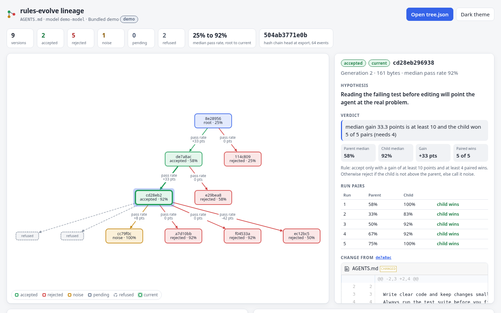
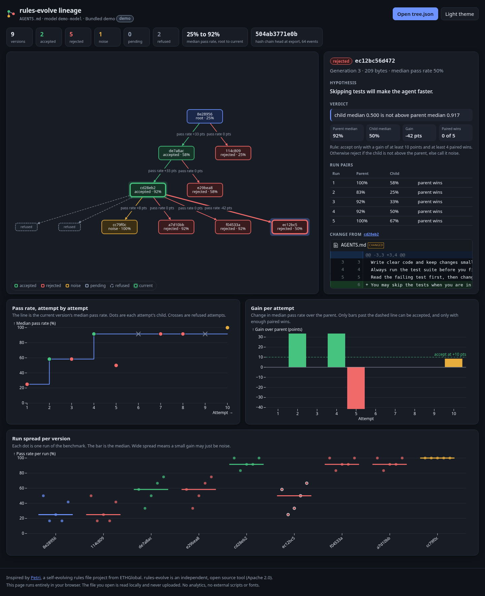

# rules-evolve (working name)

A small command line tool that helps you improve your repo's agent rules file
(`AGENTS.md`, `CLAUDE.md`, or a file in `.cursor/rules`) with measurements
instead of gut feeling.

The idea:

- The model stays fixed. Only the rules file changes.
- Each change is a small mutation of its parent version, with a plain-English
  hypothesis ("tell the agent to run the tests first").
- Each version is benchmarked on tasks taken from your own repo, several times,
  and the median is used.
- A change is kept only if it clearly beats its parent. Otherwise it is
  rejected or marked as noise.
- Every attempt, including failures and refused changes, is written to an
  append-only, hash-chained log. The lineage tree is rebuilt from that log.

It runs locally. Nothing is uploaded anywhere.

## Install from source

You need Rust (stable; tested with 1.100.0, from https://rustup.rs) and, on Linux,
`bwrap` (bubblewrap) for isolated checks. There are no published packages: you
build it yourself.

```sh
git clone <this repo> rules-evolve
cd rules-evolve
cargo install --path crates/cli --locked   # puts rules-evolve in ~/.cargo/bin
rules-evolve --version
```

Or run it from the build folder with `cargo build --release` and
`target/release/rules-evolve`. The viewer is optional and needs Node.js (see
"Viewer").

## Quickstart (free, about a minute)

The demo replays a recorded ten generation lineage. No model, no key, no
network:

```sh
examples/demo/demo.sh
```

It prints each generation, then `status` and `verify-log`: 2 accepted, 5
rejected, 1 noise and 2 refused mutations, and an intact log. Then look around
the folder it printed:

```sh
rules-evolve -C <folder> digest            # what worked, what failed, what to try
rules-evolve -C <folder> log --limit 5     # the newest events of the log
rules-evolve -C <folder> apply             # diff of the best version (dry run)
rules-evolve -C <folder> export --out tree.json
```

Open `tree.json` in the viewer (`cd viewer && npm ci && npm run dev`) to see the
lineage as a graph. On your own repo, start with `rules-evolve init --model
<name>`, write tasks in `.rules-evolve/tasks.toml`, and run `evolve` with the
free `local` provider (see "Local model test").

**Using it on your own repo:** start from
[`examples/starter/`](examples/starter/STARTER.md). It has a commented
`tasks.toml` template, a walkthrough (tasks from your existing tests and past
bug fixes, picking held out tasks, running cheaply, Windows), and a tiny
sample repo that `examples/starter/try.sh` runs end to end for free.

## What the real model runs found

With a free 7B model (Qwen2.5 Coder 7B Instruct, CPU only) on 8 tasks taken
from more-itertools, the loop accepted a rule the model wrote: "Import the
`islice` function from the `itertools` module". It took the median pass rate
from 50% to 75%, 5 of 5 paired wins, twice in a row. On 8 held out tasks the
model never saw, that same rule scored 37.5% against 50% for the starting
rules: it had fitted the benchmark, not taught a general lesson. A hand written
general rule ("import everything you use") gained on both sets (+25 on train,
+12.5 on held out). Since v2.3.0 the tool can hold tasks out and calls such a
result **overfit** instead of accepting it. On a bigger set of 48 tasks (24
train, 24 held out, one task about 4.2 points) nothing cleared the bar: the
hand written rule gained 6.2 points on train and none on held out, the
`islice` rule lost 4.2 on train, and a new 7B evolve proposed another generic
import rule that was rejected. Those runs used 2 repeats instead of 5 to fit
the time. A rerun with short prompts (each task sees only its own file, about
16 times fewer tokens) gave every version 5 runs: the hand written rule fixed
the two `islice` tasks but lost others (+4.2 train, -4.2 held out, noise),
and three evolved generic import rules were rejected (0.0, 0.0, -4.2). Details and caveats are in
"Local model test" and, in plain words, in [`docs/writeup.md`](docs/writeup.md).

## Inspiration

This project is inspired by [Petri](https://ethglobal.com/showcase/petri-mjy1y)
(ETHOnline 2026). Petri is the inspiration only. The angle here is different:
a local tool that evolves a repo's rules file against that repo's own tasks.

## Status: v2.7.2

The default is a deterministic **mock model**, so nothing costs money or touches
the network. Since v2.1.0 there is a free real provider, `local`: a model server
on your own machine (for example llama.cpp), localhost only. Since v2.5.0 there
are two paid providers, `anthropic` and `openai`, which **cost money on your own
API key** and only run with `--allow-spend`. They have only been tested against
a fake local server.

Done in Phase 1:

- Cargo workspace: `crates/core` (engine library) and `crates/cli` (the
  `rules-evolve` binary).
- Append-only, hash-chained log with tamper and truncation checks.
- Tree rebuilt from the log. Rules file versions are stored by content hash.
- Commands: `init`, `status`, `log`, `verify-log`.

Done in Phase 2 (the benchmark harness):

- A `Model` trait (the provider abstraction) and a seedable `MockModel`.
- `tasks.toml` parsing: id, prompt, shell check, optional timeout.
- A sandboxed worktree per attempt that keeps benchmark files away from the
  model (threat model and limits below).
- `run`: runs a rules version `repeats` times over the task set, records every
  run, and enforces the token cap.
- `verify`: compares a child to its parent with the fixed public rule and
  records a verdict.
- `propose`: a temporary way to add a child version from a file, so `run` and
  `verify` can be used before the real `mutate` exists.

Done in Phase 3 (model driven mutation and replay):

- `mutate`: asks the model for one small rules change plus a hypothesis, checks
  it, and records `mutation_proposed` or `mutation_refused`.
- `evolve --generations N`: loops mutate, run, verify, and moves `current`
  forward only when a child is accepted.
- Recording and replay: any provider can record every request and response into
  a replay file. The `replay` provider answers from that file with zero cost and
  fails clearly when it has no answer.
- A committed demo in `examples/demo/` that runs a full lineage with no key.

Done in Phase 4 (digest, export and the static viewer):

- `digest`: a plain English brief of the lineage: what worked, what failed
  (rejected and refused, with reasons), what is noise, what is pending, and
  directions not tried yet. Markdown or `--json`. No model is called.
- `export --out tree.json`: the whole lineage as one JSON file, described by
  the versioned schema in `schema/export.v1.json` and validated against it in
  tests.
- A static viewer in `viewer/` (Vite, TypeScript, Svelte, Cytoscape.js, Observable
  Plot, diff2html) that opens that file. The build is one `index.html` that works
  from disk with no server, no key and no network.

Done in v1.1 (the optional `watch` terminal view):

- `watch`: a live ratatui view that follows the log while another process runs
  `evolve`. It is read only, lives in its own crate (`crates/watch`), and the
  core crate has no terminal dependencies. See "Watch" below.
- `--pace MS` for the replay provider, so a replayed demo plays at a watchable
  speed.

Done in v1.2 (isolation for the check command):

- A pluggable isolation backend for the check command and the code it pulls in:
  `bwrap`, `docker`, `podman`, `none` (unsafe, labeled), and `auto`. Set in the
  `[sandbox]` table of `config.toml`, with a `--isolation` override.
- Each `run_recorded` event records the backend that was used.
- A policy in code: a provider declared `Real` cannot run unless the isolation is
  `bwrap`, `docker` or `podman`. No such provider exists yet.
- Real escape tests for every backend that works on the machine running them.
  See "Sandbox and threat model" for what ran where.

Done in v1.2.1 (hidden tests are read only during the check):

- Hidden files and folders are kept as pristine copies outside every worktree.
  Under `bwrap`, `docker` and `podman` they are mounted read only over their own
  paths for the check, so code the model wrote cannot edit, delete, rename or
  replace them. Under `none` the pristine copy is put back before the check, and
  nothing stops writes after that.

Done in v1.2.2 (shadow warnings at scan time):

- When the sandbox is scanned, risky layouts are reported with a plain fix: a
  hidden file in a folder that is not hidden, a writable folder around hidden
  files, and runner config (`conftest.py`, `pytest.ini`, `package.json`,
  `Cargo.toml`, `Makefile` and so on) that the model can edit and the check
  likely reads. See "Shadow warnings" in "Sandbox and threat model".
- `[sandbox] shadow_warnings = "warn" | "error" | "off"`, default `warn`.

Done in v1.2.3 (polish found while reviewing screenshots and video):

- Viewer charts: the y axes always leave room above and below every bar and dot
  and include the accept threshold, with tidy ticks. Badge text is darker in the light theme
  so it reads (contrast of at least 4.5 to 1).
- `watch`: the run progress shows one bar per run on a fixed 0 to 100% scale,
  and the SVG picture draws block characters as rectangles.

Done in v1.2.4 (readable lineage graph):

- The viewer graph text is larger. The gain now sits inside each node ("accepted
  · 92%", "+33 pts") instead of on edge labels, and refused attempts are a
  "2 refused" line on the version, listed with their reasons in the details
  pane. The "Show refused" button draws them as dashed boxes. The viewer picks
  top down or left to right by whichever fits better, and never fits a tree
  below a readable size: a big tree opens zoomed in around the current version
  with a hint, and "Fit all", "Current" and plus and minus buttons. At 1280 by
  800 the demo text is about 15 px and a 34 version tree about 12 px (it was
  9 px and 3 px). `viewer/test-fixtures/wide-tree.json` is a synthetic wide
  tree used by the tests and the smoke check.

Done in v2.0.0 (Claude Code plugin):

- `integrations/claude-code/` holds a Claude Code plugin and a small local
  marketplace. Seven slash commands (`/rules-evolve:status`, `digest`,
  `verify-log`, `export`, `propose`, `evolve`, `init`) shell out to the
  `rules-evolve` binary, and two hooks (a session start status line and a warning
  when the rules file is edited directly) are on only in repos that have
  `.rules-evolve/`. Mock and replay only: the plugin refuses any other provider.
  See "Claude Code plugin" below.

Done in v2.1.0 (free local model test):

- `--provider local`: talks to an OpenAI compatible model server on
  `localhost`, `127.0.0.1` or `[::1]` only, over plain HTTP. Any other URL is
  refused before a connection is made. No key, no spend. Its provider kind is
  `LocalModel`, which, like `Real`, must run with `bwrap`, `docker` or `podman`
  isolation, because the checks execute what the model wrote.
- `--local-transcript FILE` keeps every raw reply for debugging. For the local
  provider, `--record` and `--local-transcript` files may not sit where the
  model would read them as project files.
- `examples/local-model/`: setup, a task set derived from more-itertools,
  and an honest result: with a 3B model nothing was accepted, and the run
  could not tell whether rules-evolve helps. Recorded answers from that
  3B run are not in this repo (its weights use the Qwen Research license).
  See "Local model test" below.

Done in v2.2.0 (failure details in the mutation prompt):

- Failed attempts keep a short failure note in the log (files written, and the
  end of the check output with hidden file lines removed). The check's stdout
  and stderr are now read (the last 8 KiB of each) instead of discarded.
- The mutation prompt has a "Benchmark results" section: median pass rate,
  per task pass counts, and the notes of the tasks that failed most, bounded
  to 3000 bytes. See `mutate` below.
- `evolve` runs the parent before it mutates, so even the first mutation sees
  results.
- Fix: on a timeout under `isolation = "none"`, processes started by the check
  were not killed when `/bin/sh` is dash. They are now.
- Why a minor version: the log gains an optional field (old logs still read),
  and mutation prompts changed, so replay files recorded with v2.1.0 miss on
  mutation calls. The committed demo replay was recorded again (mock model).
- A real run with Qwen2.5 Coder 7B Instruct (Apache 2.0, local, free) accepted
  one model written rule, +25 points, and its replay is committed in
  `examples/local-model/replays/qwen2.5-coder-7b/`. See "Local model test".

Done in v2.3.0 (held out tasks):

- A task can be marked `split = "held_out"` in `tasks.toml` (the default is
  `train`). Held out tasks run with every version, but their ids, prompts,
  counts and failure notes never reach the mutation prompt. See "Tasks".
- With held out tasks, a change the train rule accepts is kept only if it
  also gains on the held out tasks: at least 10 points of held out median and
  at least 3 of 5 held out paired wins (both configurable). Otherwise the
  verdict is the new **overfit**, and `current` does not move. See "The
  verdict rule".
- A task set with no held out tasks behaves exactly as before: same verdicts,
  same log lines, same mutation prompts, same exports.
- The log, `status`, `digest`, `export` (schema), `watch` and the viewer show
  held out numbers and the overfit verdict. The mock model can limit a marker
  to some tasks (`tasks = [...]`), to model a narrow rule.
- `examples/local-model/` has 8 held out functions next to the 8 train ones.
  See "Local model test" for what the 7B model did under the new rule.

Done in v2.4.0:

- `apply`: writes an accepted version into the repo's rules file. A dry run
  with a diff unless `--yes`, refuses versions that were not accepted unless
  `--force`, never writes outside the repo or through a symlink, and records an
  `applied` event in the log. The plugin has `/rules-evolve:apply`.

Done in v2.5.0:

- Bring your own key providers `anthropic` and `openai` (any OpenAI compatible
  endpoint). **They cost money on your own key**, need `--allow-spend` and
  `--api-model`, read the key only from an environment variable, never write
  it anywhere, and require isolation. Tested only against a fake local server.

Done in v2.6.0:

- The `docker` and `podman` backends ran the full escape and hidden file test
  suites for the first time and pass. The podman run found that rootless
  podman can silently ignore its process and memory caps; fixed with ulimits.

## Roadmap and remaining gaps

**Isolation: built in v1.2, with gaps that matter.** The check command now runs
through an operating system isolation backend (`bwrap`, `docker` or `podman`),
and a provider marked `Real` is refused unless one is in use. What is still
missing before a real provider that runs tools or code is switched on:

- A real provider's own tool execution is not wired through the isolation layer
  yet, because no provider has tools. Only the check command is isolated today.
  The policy gate is in place so a new provider has to declare itself, but the
  provider's tools must also be run through the same `Runner`.
- The container backends (`docker`, `podman`) were run for real in v2.6.0
  (Docker 29.9.3 rootful, Podman 6.2.0 rootless) and pass both escape test
  files. They were run on one Debian 13 machine only. Run
  `cargo test -p rules-evolve-core --test isolation_escape -- --nocapture` on
  your machine and read the output (see below).
- No seccomp filter and no cgroup limits for `bwrap`. See the list of gaps in
  "Sandbox and threat model".
- Files next to a hidden file, and non-hidden config the check reads, can still
  be added or changed by model code (see "A new file next to a hidden file").
  Since v1.2.2 these layouts are detected and warned about when you run, with a
  fix in plain words (see "Shadow warnings"), but they are not prevented.
  List folders, not files, in `hidden` where you can.

The paid providers (v2.5.0) have no tools either: like `local`, they return
file contents, which the harness writes and the isolated check runs. So the
first bullet above is still open only for a future provider that runs tools.
The `local` provider (v2.1.0) only talks to loopback and has no tools: it
returns file contents, which the harness writes and the isolated check runs. (The Claude Code plugin shipped in v2.0.0 and only allows `mock` and
`replay`.)

## Not doing

- No paste-your-API-key website. Keys stay on your machine.
- No claim about evolving model weights. The model never changes. Only the
  rules text evolves.

## Build and test

```
cargo build
cargo test
cargo clippy --all-targets -- -D warnings
cargo fmt --check
```

The binary is `target/debug/rules-evolve`. The viewer has its own checks, see
"Viewer" below.

The isolation escape tests (`crates/core/tests/isolation_escape.rs`) run real
attacks against each backend that works on the machine. A backend that cannot
start (not installed, no user namespaces, no daemon, image missing) is skipped
with a `SKIPPED: ...` line on stderr (run with `-- --nocapture` to see it), and
a skipped backend ran nothing. Set `RULES_EVOLVE_REQUIRE_BACKENDS=bwrap,docker,podman`
(any subset) to make a skip a failure.

The `watch` command is behind the cargo feature `watch`, which is on by default.
To build a binary without any terminal code, run
`cargo build -p rules-evolve-cli --no-default-features`.

The Claude Code plugin has its own tests, see "Claude Code plugin" below:
`integrations/claude-code/tests/run-all.sh`.

## Commands

Global options: `--json` (machine readable output) and `-C, --dir <DIR>` (repo
root, default `.`).

### `init --model <NAME> [--rules-file <PATH>]`

Creates `.rules-evolve/` in the repo. If `--rules-file` is not given, it looks
for `AGENTS.md`, then `CLAUDE.md`, then `.cursor/rules` and uses the first one
it finds. A `.cursor/rules` folder is used only if it holds exactly one file,
since one file is evolved at a time. The model name is only recorded. No model
is called.

It writes:

| Path | What it is |
| --- | --- |
| `.rules-evolve/config.toml` | Settings (see below) |
| `.rules-evolve/tasks.toml` | Task template: each task is a prompt plus a shell check |
| `.rules-evolve/.gitignore` | Ignores only `scratch/` and `sandbox/` folders, nothing else |
| `.rules-evolve/log.jsonl` | The lineage log, starting with an `init` event |
| `.rules-evolve/HEAD` | Newest `seq` and `hash`, used to spot cut off logs |
| `.rules-evolve/blobs/<sha256>` | Rules file versions, named by content hash |

**Commit `.rules-evolve/` in your repo.** The log, `HEAD`, blobs, config and
tasks are all meant to live in git, so the lineage has history that the tool
itself cannot rewrite. `init` checks with `git check-ignore` that git does not
ignore the folder. If one of your ignore rules does, `init` appends
`!.rules-evolve/` to the repo's `.gitignore` and checks again. The result is in
the `gitignore` field of the JSON output (`status` is `ok`, `fixed`,
`still_ignored`, `not_a_git_repo`, or `git_unavailable`). The only ignore file
the tool writes inside the folder covers `scratch/` and `sandbox/`.

Default settings (confirmed by the project owner, and recorded in `config.toml`
as `defaults_confirmed = true`):

| Setting | Default | Meaning |
| --- | --- | --- |
| `repeats` | 5 | Runs per version, median taken |
| `accept_threshold_pp` | 10 | Child must beat parent by 10 percentage points of median pass rate |
| `min_paired_wins` | 4 | And win at least 4 of the 5 paired runs, otherwise it is noise |
| `held_out_accept_threshold_pp` | 10 | Only with held out tasks: the child must also gain 10 points of held out median pass rate |
| `held_out_min_paired_wins` | 3 | And win at least 3 of the 5 held out pairs, otherwise it is overfit |
| `held_out_large_set_tasks` | 20 | With at least this many held out tasks (0 turns it off), use the next bar instead of 10 points (v2.7.0) |
| `held_out_large_set_threshold_pp` | 5 | Held out gain needed for a large held out set |
| `max_tokens_per_run` | 200000 | Token cap for one run |
| `max_model_errors_per_run` | 0 | Failed model calls a run tolerates (under `[evaluation]`, v2.7.2). Past it the run stops, is not recorded, and nothing is counted |
| `retries_on_refusal` | 0 | How many more times `evolve` asks for a mutation, with a new seed, after a refused one such as a repeat (under `[mutation]`, v2.7.2) |
| `max_change_bytes` | 1000 | Largest allowed change for `propose` (under `[mutation]`) |
| `one_shot_agent` | false | Tell the mutation model that the agent answers each task in one reply, runs nothing and cannot read the hidden paths of tasks.toml, so it does not propose rules such as "run the checks" (under `[mutation]`). Right for the local and API providers. False keeps the older prompt, which older replay files need |
| `isolation` | `auto` | How check commands are isolated (under `[sandbox]`, see "Sandbox and threat model") |
| `shadow_warnings` | `warn` | `warn`, `error` or `off`: what to do about layouts where model files could shadow hidden tests (under `[sandbox]`, see "Shadow warnings") |

A task in `tasks.toml` looks like this. The check command exits with 0 to pass.

```toml
[[task]]
id = "example-fix-failing-test"
prompt = "The test suite has one failing test. Fix the code so all tests pass."
check = "cargo test --quiet"
```

### `status`

Shows whether the log is intact, the settings, and a summary of the tree:
versions, mutations (accepted, rejected, noise, pending), refused mutations,
recorded runs, and each edge with its hypothesis and verdict. If the log fails
verification, the tree is not shown.

### `log [--limit N] [--kind KIND]`

Lists events in order. `--limit N` shows the newest N. `--kind` is one of
`init`, `mutation_proposed`, `mutation_refused`, `run_recorded`, `verdict`,
`applied`.

### `verify-log`

Checks the hash chain, the `HEAD` file, and that every stored rules file
matches its hash.

### `propose --file <PATH> --hypothesis <TEXT> [--parent <VERSION>]`

Temporary. Adds a child rules version from a file holding the full new text.
`--parent` is `root`, `current` (default), a full hash, or a hash prefix of at
least 4 characters. The engine stores the text by hash and writes a
`mutation_proposed` event. It is replaced by the model driven `mutate` in
Phase 3.
For a model written change use `mutate` instead.

There is a size limit: the changed part (what is cut out or put in, after
trimming the shared start and end) may not be larger than
`[mutation] max_change_bytes` in `config.toml` (default 1000 bytes). Too big,
identical to the parent, or already in the tree: nothing is added, a
`mutation_refused` event is written, and the exit code is 3. The hypothesis
must not be empty, and the file must be UTF-8 text.

### `run [--version V] [--repeats N] [--seed S] [provider options]`

Runs one rules version over the whole task set `repeats` times (default from
`config.toml`, 5) and writes one `run_recorded` event per run, with the pass
rate (`passed` and `total`), tokens used, and the seed. `--version` is `root`,
`current` (default), or a hash or prefix, so you run the parent and the child
the same way.

- Run `i` uses the seed derived from `--seed` and `i`. Use the same `--seed`
  for parent and child so that run `i` of each is paired. The default is 0.
- Runs already in the log are skipped, so you can stop and start again, or ask
  for more repeats. A different `--seed` for an already recorded run is an
  error.
- **Token cap.** Each run (one pass over all tasks) may use at most
  `max_tokens_per_run`. Before each model call the harness asks the provider
  for a token estimate and does not make the call if it would go over the cap.
  The rest of the tasks in that run are marked `skipped_budget` and count as
  failed, and the run is recorded with `budget_exhausted: true`. If a provider
  ever reports more tokens than were left, its answer is thrown away
  (`over_budget`) and the run stops with `tokens_used` set to the cap. The
  recorded tokens for a run never go over the cap.
- Provider options are shared with `mutate` and `evolve` (see "Providers,
  recording and replay"). Only `mock` and `replay` exist. Any other name is an
  error.
- `--isolation auto|bwrap|docker|podman|none` overrides `[sandbox] isolation`
  from `config.toml` for this command (also on `mutate` and `evolve`). The
  output ends with an `Isolation:` line, and `none` is printed as
  `none (UNSAFE: no operating system isolation)`. A backend you asked for by
  name that cannot start is an error, never a quiet fallback.

### `mutate [--parent V] [--seed S] [provider options]`

Asks the model for one small change to a rules version (default `current`) and a
plain English hypothesis, then validates and records the answer.

The mutation prompt is built from four things: the rules text being changed,
the benchmark results of that version, the history of the lineage (what was
accepted, rejected, noise, pending and refused, with the hypothesis for each
and the median change for judged ones, oldest first, at most the latest 40
lines), and the size limit. The same tree always gives the same prompt text.

The benchmark results (since v2.2.0) come from the runs already recorded for
the version, train tasks only (held out tasks are never shown, see "Tasks"): the number of runs and the median pass rate, how often each task
passed, and for the tasks that failed most (at most 6), the task prompt and
the failure note the harness kept. The section is at most 3000 bytes. A
version with no runs yet gets "No benchmark runs of this version yet."

**Failure notes.** When a task fails, the harness keeps a note of at most 600
bytes in the `run_recorded` event (`tasks[].detail`): the files the model
wrote (or "Wrote no files."), whether the check timed out, and the end of what
the check printed (stdout, then stderr). Model errors and path violations get
a one line note. Before anything is kept, every output line that matches a
line of a hidden file (lines of 4 or more characters, and longer lines also
inside an output line) is replaced with `[line from a hidden file]`, color
codes are dropped, and worktree paths are shown as `.`. So a traceback that
quotes a hidden test keeps the error and the values the check printed, but not
the test source. The check's own message (for example `AssertionError: [0, 1]
!= [0, 1, 2]`) does reach the mutating model: that is the point. If your check
prints secrets or expected answers in its own words, that text is not a hidden
file line and is kept.

Checks on the answer, using the same rules as `propose`. Any failure writes a
`mutation_refused` event, nothing is added to the tree, and the exit code is 3:

- the hypothesis is empty;
- the new rules text is empty;
- the new text is identical to the parent;
- the new text already exists as a version in the tree;
- the new text differs from the parent, or from a version in the tree, only
  in whitespace (v2.7.2);
- the change is larger than `[mutation] max_change_bytes` (1000 bytes);
- the model reports more tokens than `max_tokens_per_run`, or a call would be
  estimated to go over it. The model's answer is then thrown away.

A valid answer writes `mutation_proposed`. Both events also record the
`seed`, `provider` and `tokens_used` of the call. If the model itself fails
(including a replay miss) the error is returned and nothing is written.

`--seed` is passed to the model as is. The same seed, tree and provider give
the same mutation.

### `evolve --generations N [--seed S] [--total] [provider options]`

Runs `N` generations (1 to 100). With `--total`, `N` is the total for the
project: judged children and refused attempts already in the log count
(children added with `propose` too), so the same command run again after a
cut off session stops at the same total instead of adding `N` more. An
unjudged child is finished first and counts as one. Each generation:

1. `run` the parent (`current`) with `--seed` as the run seed, so the
   mutation prompt can show how it did (runs already in the log are reused);
2. `mutate` from `current`, with a mutation seed derived from `--seed` and the
   number of earlier attempts in the tree;
3. if the mutation was recorded, `run` the child with the same run seeds;
4. `verify` the child with the fixed rule.

Before v2.2.0 the parent ran after the mutation, so the first mutation never
saw any results.

`current` moves to the child only on `accepted`. Rejected, noise and refused
generations leave it where it was, so later generations keep building on the
best version so far. The same `--seed`, settings and provider give the same
lineage, so you can also continue a lineage by running `evolve` again. The
report lists each generation with its mutation, verdict, and `current`.

What `evolve` does when things go wrong (v2.7.2):

- **A repeated or unusable mutation.** With `[mutation] retries_on_refusal =
  N`, a refused answer (a repeat of the parent or of any version in the tree,
  a whitespace only change, an empty or unreadable answer, a change over the
  size limit) is recorded as refused and the model is asked again with the
  next seed, up to `N` more times. Token cap refusals are not retried. The
  default is 0, the behaviour before v2.7.2, so existing replays stay
  identical. A retry that a replay file never recorded ends the generation
  with the last refusal instead of failing.
- **The model server dies.** A failed model call stops the run: it is not
  recorded and no task is counted as failed, so a dead server can no longer
  turn into a fake "rejected" verdict. Set `[evaluation]
  max_model_errors_per_run` to tolerate some failed calls (they count as
  failed tasks, as before v2.7.2). Run `evolve` again once the server is back.
- **Resuming.** A child that was proposed but not judged when the last
  session stopped is finished first (its missing runs and its verdict), with
  no new mutation call, so an interrupted generation is never duplicated.
  Runs already in the log are reused. Without `--total` the resumed child is
  the first of `N` new generations, so a session cut off in generation 2 of 3
  and run again with `--generations 3` ends with 4. Use `--total` (or pass
  the number still missing) to keep the planned count.
- **The token cap.** A run that hits `max_tokens_per_run` is recorded (its
  tasks not done count as failed), no further run of that version starts,
  and the output says so with the numbers. `verify` refuses to judge capped
  runs, and `evolve` stops with the same note.
- **A half written log.** If a crash left an incomplete last line in
  `log.jsonl`, the next command that writes moves it to `log.jsonl.partial`.
  A whole last event without its newline gets one, and a `HEAD` exactly one
  event behind is brought up to date. Anything else (an edited event, `HEAD`
  further behind) is left alone and still fails `verify-log`.

### `isolation`

Shows which isolation backends start on this machine (`bwrap`, `podman`,
`docker`, each with the reason when it does not) and which one `auto` would use.
`--json` gives `configured`, `image`, `backends`, `auto`, `shadow_warnings` (the
mode) and `warnings` (the shadow warnings for this repo, see "Shadow warnings").
The text output ends with a "Shadow warnings" section. It runs a trivial
command in each backend, so a container backend needs its image present.

### `verify --child V`

Compares the child to its parent with the fixed rule below and writes a
`verdict` event. Both versions need runs `0..repeats` recorded with matching
seeds and task counts, otherwise it tells you what to run first. A child gets
one verdict.

### `digest`

Prints a brief of the lineage as Markdown, or as JSON with `--json` (the digest
is the `data` field). It reads the log, so it refuses to run when the hash chain
fails verification. Sections:

- **What worked**: accepted changes, with the hypothesis, the gain in points, the
  paired wins, and the median pass rate before and after.
- **What failed**: rejected changes with the verdict reason, and refused
  mutations with the reason they were refused.
- **Noise**: changes that gained a little but not clearly.
- **Pending**: versions that have no verdict yet.
- **Directions not tried yet**: suggestions.

The suggestions are deterministic and come from fixed rules, not a model: run
the pending changes, retest noisy gains with more repeats, retry a smaller
version of a change refused for size, build on the latest win, explore or avoid
the words that only show up in accepted or only in rejected hypotheses, widen
the proposals when several were refused as repeats, and finally name common
rules file topics (testing, reading before editing, small changes, checking its
own work, edge cases, asking when unsure, style, commits, docs, tools, planning)
that no hypothesis has mentioned yet. The word themes are a simple keyword
heuristic and are only a hint. The same lineage always gives the same digest.

A sample from the demo (the full file is `examples/demo/digest.md`):

```
# Rules lineage digest

Rules file: `AGENTS.md`. Model: `demo-model`.

9 versions and 8 mutations tried: 2 accepted, 5 rejected, 1 noise, 0 pending. 2 refused before they became versions.

Current version: `cd28eb296938` (root `8e28956afd69`). Median pass rate moved from 25% to 92% (+66.7 points).

## What worked

- **Telling the agent to run the test suite before it finishes will catch more mistakes** (`de7a8ac7ef75`, +33.3 points, 5 of 5 paired wins). Median pass rate 25% to 58%.
- **Reading the failing test before editing will point the agent at the real problem** (`cd28eb296938`, +33.3 points, 5 of 5 paired wins). Median pass rate 58% to 92%.

## What failed

### Rejected

- Skipping tests will make the agent faster (`ec12bc56d472`, -41.7 points). child median 0.500 is not above parent median 0.917
...
```

### `apply [--version <VERSION>] [--yes] [--force]`

Copies a version from `.rules-evolve/blobs/<hash>` into the rules file named
in `config.toml` (`AGENTS.md`, `CLAUDE.md` or the file under `.cursor/rules`).
No model is called. `--version` is `current` (the default, the newest accepted
version), `root`, a full hash or a unique hash prefix.

- **Dry run by default.** Without `--yes` it prints a unified diff from the
  file on disk to the version and writes nothing. With `--yes` it writes the
  same change.
- **Accepted versions only.** A version that is root, pending, rejected, noise
  or overfit is refused (exit code 1, nothing written) unless `--force` is
  given. `current` is root when nothing has been accepted yet, so it needs
  `--force` too.
- **Checked before writing.** The log must verify, and the stored text must
  still match its hash.
- **Inside the repo only.** The rules file path must be relative, without
  `..`, outside `.rules-evolve/` and `.git/`, and no part of it may be a
  symlink. The parent folder must already exist. The file is written to a
  temporary file next to it and renamed into place.
- **Logged.** A write appends an `applied` event (version, rules file, the
  sha256 of the text it replaced, the version's status, and whether `--force`
  was used). If the file already holds that version, nothing is written and
  nothing is logged.

`applied` events do not change `current` or any verdict: they only record that
a version was put on disk. A log with an `applied` event cannot be read by
binaries older than v2.4.0, which reject unknown event kinds. Commit the rules
file and `.rules-evolve/` together after an apply.

### `export --out <PATH>`

Writes the lineage as one JSON file for the viewer. `--out -` prints it to
standard output instead (with `--json` it becomes the `data` field). The export
is only written when the log verifies. It holds every version with its full text
and its diff from the parent, every edge with its hypothesis, verdict, reason,
medians, gain and run pairs, every refused mutation, per attempt series for the
charts, the thresholds from the config, and the hash chain head at export time.
It has no timestamps and no file paths, so the same log always exports to the
same bytes.

The format is described by [`schema/export.v1.json`](schema/export.v1.json)
(JSON Schema draft 2020-12). Tests validate real exports against it, and the
viewer validates every file it opens against the same schema. Version 1 never
removes or renames a field. A change to an existing field means a new version
number and a new schema file. Since v2.3.0 version 1 also has optional held
out fields (`held_out_passed`, `held_out_total` and `held_out_pass_rate` on
runs, `held_out_median_pass_rate` on nodes, `held_out_parent_median`,
`held_out_child_median`, `held_out_gain_pp` and `held_out_paired_wins` on
edges, the two gate settings under `config`, `overfit` under `summary`) and
the verdict `overfit`. They appear only when the lineage has held out tasks,
so older lineages export to the same bytes as before.

### Exit codes

| Code | Meaning |
| --- | --- |
| 0 | Success |
| 1 | Error (not initialized, bad arguments, broken log for `log`, and so on) |
| 2 | `status` or `verify-log` ran, but verification failed |
| 3 | `propose` ran, but the change was refused and logged |

## Tasks

`.rules-evolve/tasks.toml` holds the benchmark tasks and the sandbox settings.

```toml
[sandbox]
hidden = ["tests", "check.sh", "**/*_test.go"]   # benchmark files, see below
exclude = ["target", "node_modules"]             # never copied (the default)
env_passthrough = []                              # variables check commands may see
default_timeout_secs = 60

[[task]]
id = "fix-parser-bug"          # letters, digits, _ - . only, unique
prompt = "The date parser fails on leap days. Fix it."
check = "sh tests/run.sh fix-parser-bug"   # exit 0 means pass
timeout_secs = 120             # optional, overrides default_timeout_secs
split = "train"                # optional: "train" (default) or "held_out"
context = ["src/date.rs", "src/parse/"]   # optional (v2.7.0): the only files shown
```

**Context (v2.7.0).** By default the model is shown every readable file in
the repo (up to 48 KB). `context` limits one task's prompt to the listed
files, and to everything under a listed folder (a path ending in `/`). Paths
are relative to the repo root and may not contain `..`. Use it when the repo
holds many files a task does not need: on the 48 task more-itertools set it
cut each task prompt from about 9,700 to about 600 tokens. A task without
`context` gets exactly the prompt it got before, and its replay key is
unchanged, so older recordings still replay. The list is part of the replay
key when it is set.

**Held out tasks (v2.3.0).** Mark a task `split = "held_out"` to keep it out
of the model's sight while the rules are written. Held out tasks are run with
every version, in the same runs and with the same seeds as the train tasks,
and their outcomes are logged (marked `held_out`), but:

- the mutation prompt never names them: no id, prompt, pass count or failure
  note, and the median it shows is the train median;
- in the history part of the prompt, an overfit change is listed as
  `[rejected]` with its train medians, so the model does not learn held out
  results from the history either;
- when there are held out tasks the prompt adds one fixed sentence: the rules
  are also scored on other tasks that are not shown, so a general habit beats
  a fix for one task. That sentence says nothing about the tasks themselves.

Use them to catch rules that only fit the tasks they were tuned on. Pick held
out tasks that are like the train tasks but not the same ones. A set where
every task is held out is an error. The hidden check files of held out tasks
are protected the same way as all others. Note that the model doing a task
still sees the repo, so the stub or source files of held out tasks are visible
to it like any other file, as they would be in real work; only the mutating
model is kept from the held out results.

If you add held out tasks to a project that already has runs, `verify` refuses
to judge pairs whose runs did not score the same held out tasks, and asks for
new runs.
Unknown keys are errors, so typos do not pass silently. Paths in `hidden` and
`exclude` are relative to the repo root. A path covers everything under it. `*`
matches inside one folder level, `**` matches any number of levels, `?` matches
one character.

## Providers, recording and replay

A provider is anything that implements the `Model` trait in `crates/core`: it
answers tasks and proposes mutations, and reports an estimate of its token use.
The harness uses nothing else. The free providers never leave this machine:
`mock` and `replay` make no calls, and `local` only talks to a server on
loopback. Since v2.5.0 there are two paid ones, `anthropic` and `openai`, which
call a remote API on your own key (see "Paid providers (your own key)" below).

Options shared by `run`, `mutate` and `evolve`:

| Option | Meaning |
| --- | --- |
| `--provider mock\|replay` | Which provider to use (default `mock`) |
| `--mock-config PATH` | Mock settings (default `.rules-evolve/mock.toml`) |
| `--replay-file PATH` | Replay file to answer from (for `--provider replay`) |
| `--record PATH` | Record every model request and response into this file |
| `--provider local` | A model server on this machine (see "Local model test") |
| `--local-url URL` | Its base URL, default `http://127.0.0.1:8080`. The host must be `localhost`, `127.0.0.1` or `[::1]`, plain `http`, no path, user info, query or fragment |
| `--local-temperature T` | Sampling temperature, 0 to 2, default 0.7 |
| `--local-max-new-tokens N` | Most tokens per reply, default 1024 |
| `--local-timeout SECS` | Time limit per call, default 600 |
| `--local-transcript FILE` | Append every raw reply to this JSON Lines file |
| `--provider anthropic\|openai` | PAID, on your own key. Needs `--allow-spend` and `--api-model` |
| `--allow-spend` | Confirms a paid provider may bill your key. Never set by a config file |
| `--api-model MODEL` | Model id sent to the API. No default |
| `--api-url URL` | Default `https://api.anthropic.com` or `https://api.openai.com/v1`. Must be `https`, or `http` to localhost only |
| `--api-key-env VAR` | Environment variable holding the key, default `ANTHROPIC_API_KEY` or `OPENAI_API_KEY` |
| `--api-temperature T` | 0 to 2, default 0.7 (sent as at most 1 to Anthropic) |
| `--api-no-temperature` | Send no temperature (newer models such as `claude-haiku-5-5` refuse it) |
| `--api-max-new-tokens N` | Most tokens per reply, default 1024, at most 16384. Thinking counts too |
| `--api-thinking adaptive\|off\|between_tools` | Anthropic only. `off` sends `thinking: disabled`, so the whole cap goes to the answer. `between_tools` is the same for `claude-sonnet-5-5`, which refuses `disabled`. Unset sends nothing (the model's default, adaptive thinking on newer models) |
| `--api-effort LEVEL` | Anthropic only: `low`, `medium`, `high`, `xhigh` or `max`, sent as `output_config.effort`. `--api-thinking off` and `between_tools` need `low`, `medium` or `high` |
| `--api-timeout SECS` | Time limit per call, default 300 |
| `--api-transcript FILE` | Append every raw reply, the provider's token usage and why the reply ended (`stop_reason`, `max_tokens` means cut off at the cap) to this JSON Lines file (the key is never in it) |

**Recording.** `--record` works with any provider that makes calls (the mock now,
real providers later). Each call is stored in a replay file, which is JSON Lines.
The first line is a header naming the provider. Every other line is one call:

```json
{"type":"header","format":1,"provider":"mock"}
{"type":"entry","key":"3f9a...","kind":"task","model":"demo-model","task_id":"task-01","seed":123,"rules_hash":"8e28...","prompt_sha256":"b1c2...","response":{"edits":[{"path":"answers/task-01.txt","content":"ok\n"}],"tokens_used":1008}}
```

The `key` is the SHA-256 of the canonical JSON of `{kind, model, prompt_sha256,
provider, rules_hash, seed, task_id}`. So the same provider, model name, prompt,
rules version, task and seed always find the same answer, and a change to any of
them is a miss. For a mutation call, `kind` is `mutation`, the prompt is the
mutation prompt, `rules_hash` is the parent version, and `task_id` is empty.
Recording appends to an existing file of the same provider and skips calls it
already has with the same answer. A call made again with a different answer
(a run redone after a model error stopped it, so the log used the new answer)
is appended, and when a file is loaded the later entry for a key wins. A file
from another provider is refused.

**Replay.** `--provider replay --replay-file PATH` answers only from the file.
It never calls anything, so it costs nothing. The recorded token counts are
served too, so the token cap behaves exactly as it did when recording, and a
replayed run gives the same pass rates, tokens, hypotheses, hashes and verdicts
as the recorded one (only timestamps and the `provider` field in the log differ,
which says `replay`). If the file has no answer for a request, the command stops
with a `replay miss` error that names the task, rules version and seed, and
nothing from that run is written. Record the file again with `--record` if you change the model
name, tasks, prompts, rules or seeds.

One exception for mutations: a mutation prompt carries failure notes from
real check output, which is not always byte for byte the same between a
recording and its replay. So when the exact key of a mutation misses, replay
uses the recorded mutation with the same model name, parent version and seed,
if there is exactly one. Task calls are always matched exactly. Now
failure notes also drop test run times (`Ran 3 tests in 0.002s`), the one part
that changed on every run.

### Paid providers (your own key)

**Using these costs real money, billed to your own API account.** Every task
attempt is one call and every mutation is one call. A default `evolve` with 8
tasks, 5 repeats and 3 generations makes up to 40 + 3 x (1 + 40) = 163 calls
(40 runs of the root, then one mutation and 40 runs of each child; the 7B
local run 1 made exactly 163), and each task call sends the rules and the repo
files the model may read. The 7B local runs used about 1,200 to 2,000 tokens
per call. Check your
provider's prices before you start, and set a spending limit in your provider
account. The per run token cap (`max_tokens_per_run`, default 200000) stops a
run, but it is not a money limit. rules-evolve has never been run against a
paid endpoint by its author: the code is tested only against a fake server on
127.0.0.1.

- `anthropic` speaks the Messages API (`POST /v1/messages`, `x-api-key` and
  `anthropic-version: 2023-06-01` headers).
- `openai` speaks chat completions (`POST {url}/chat/completions`, a Bearer
  token). Any OpenAI compatible service works through `--api-url`. It sends
  `max_tokens`, `temperature` and `seed`; a service that refuses one of these
  answers with an HTTP error, which stops the run.

Example (bills your key):

```sh
export ANTHROPIC_API_KEY=...   # in your shell, never in a file in the repo
rules-evolve evolve --generations 3 --provider anthropic \
  --api-model <model id> --allow-spend --isolation bwrap
```

A first real run with `claude-haiku-5-5` (9 tasks, 4 generations, about
$0.07) is recorded in `examples/claude/haiku-5-5-run1/`, with its log, cost
and a free replay. A second run (16 tasks, the run 1 rule as a control plus
3 generations, $0.14) is in `examples/claude/haiku-5-5-run2/`.
Runs 3 and 4 (`examples/claude/haiku-5-5-run3/`, `sonnet-5-5-run4/`,
$0.98) took more-itertools held out tasks from 31% to 50% with a hand
written general rule; the rest needed behavior the docstrings never state.
Run 5 (`examples/claude/haiku-5-5-run5/`, $0.13) used
[`examples/honest/`](examples/honest/README.md), where the docstrings state
everything the checks test: the starting rules already pass 100% of train and
held out tasks.

Safety rules, enforced in code and tested:

- Nothing is sent unless `--allow-spend` and `--api-model` are on the command
  line and the key variable is set. These checks run before any connection.
- The key is read only from the environment. There is no flag or config
  setting for the key itself, and a value that looks like a key in
  `--api-key-env` is refused. It is never written to the log, replay files,
  transcripts, JSON output or error messages (error text from the server is
  scrubbed of it), and the provider's debug form shows `<redacted>`.
- `https` only, except `http` to localhost (for a local proxy, and for the
  tests). Redirects are not followed and proxy settings in the environment are
  ignored.
- The provider kind is `Real`, so a run is refused without an isolation
  backend, exactly as before. The model's files are still written by the
  harness and checked in isolation; the provider runs no tools.
- The Claude Code plugin never runs these: its wrapper refuses any provider
  but `mock` and `replay`, and refuses `--allow-spend`.

Record a paid run with `--record` (outside the repo or under `.rules-evolve/`)
and you can replay it later for free with `--provider replay`.

## Local model test

`--provider local` sends each task to an OpenAI compatible server running on
this machine (`/v1/chat/completions`, with the run seed). The prompt holds the
rules, the visible project files (hidden files and `.rules-evolve` are never
shown) and the task. The model answers with `FILE: path` lines, each followed
by a fenced block with the whole new file. A mutation answer has a `HYPOTHESIS:`
line and a `RULES:` block; an answer in another shape is recorded as a refusal.
The connection goes to a resolved loopback address only (no DNS, no TLS, no
redirects), and the peer is checked to be loopback.

Run it with a free Apache 2.0 model and llama.cpp (see
`examples/local-model/README.md` for a 1.5B or 7B setup), then replay your
own recording for free:

```sh
cargo build --release
# start llama-server on 127.0.0.1:8080 first, see examples/local-model/README.md
OUT=/tmp/lm-out examples/local-model/run-local-test.sh demo
OUT=/tmp/lm-out examples/local-model/run-local-test.sh oss /path/to/more-itertools
examples/local-model/replay.sh demo /tmp/lm-out/demo-replay.jsonl
```

Replay the committed 7B run for free (no model server):

```sh
examples/local-model/replay.sh oss /path/to/more-itertools \
  examples/local-model/replays/qwen2.5-coder-7b/oss-replay.jsonl \
  examples/local-model/replays/qwen2.5-coder-7b/oss-oracle-replay.jsonl
```

**Result with Qwen2.5 Coder 7B Instruct (Apache 2.0) and failure notes
(v2.2.0), Nov 11, 2026.** 8 tasks derived from more-itertools, CPU only,
default rule, 3 generations: **one mutation was accepted, +25 points (median
50% to 75%), 5 of 5 paired wins**, in 27 min and 143576 tokens. With failure
notes in the prompt, every model hypothesis named the real failure (`islice`
used without an import). A generic "import necessary modules" rule changed
nothing and was rejected; the accepted rule names `islice` from `itertools`,
which fixed `take` and `nth` (0 to 5 of 5 each). A second, independent run
gave the same accept (+25, 5 of 5). Caveats: the accepted rule is narrow and
close to fitting these 8 tasks, and with only 8 tasks one fixed function
moves the pass rate by 12.5 points.

**Held out check of that result (v2.3.0), Nov 11, 2026.** The three rules
were run on 8 other more-itertools functions the mutating model never saw
(`consume`, `roundrobin`, `iter_index`, `tabulate`, `ncycles`, `powerset`,
`unique_everseen`, `first_true`), 5 runs each, seed 7:

| Rules | Train (v2.2.0 run) | Held out | Under the v2.3.0 gate |
| --- | --- | --- | --- |
| root | 50% | 50% (4, 5, 4, 4, 4) | |
| model: "Import necessary modules" | 50%, rejected | 50% (4, 4, 5, 5, 4), +0.0, 2 of 5 wins | rejected (train) |
| model: "Import the `islice` function" | 75%, accepted, +25, 5 of 5 | 37.5% (2, 5, 3, 4, 3), **-12.5, 0 of 5 wins** | **overfit** |
| hand written: import everything you use | 75%, +25, 5 of 5 | 62.5% (5 of 8 in all 5 runs), +12.5, 4 of 5 wins | accepted |

So the rule the 7B model got accepted does not generalize: on new tasks it
made things worse (`tabulate` 5 to 3 of 5, `ncycles` 5 to 2 of 5, with logic
errors rather than import errors), and the new gate would have called it
overfit. The general hand written rule passes the gate. This verdict is put
together by hand from two projects (the train runs of v2.2.0 and a held out
only project), so the model saw 8 stub files per task instead of 16. A combined
7B `evolve` with both sets in one project (Nov 13, 243 calls, 662708 tokens,
94 min) accepted nothing: the model only proposed generic "import necessary
modules" rules (train 50% to 50%, held out 62.5% to 62.5%, both rejected) and
never found the `islice` rule this time, so the gate had nothing to call
overfit. Its replay is
`examples/local-model/replays/qwen2.5-coder-7b/oss-held-out-replay.jsonl`
(see `examples/local-model/README.md`). Replay the held out check for free
with `examples/local-model/replay.sh held-out-eval /path/to/more-itertools
examples/local-model/replays/qwen2.5-coder-7b/held-out-eval-replay.jsonl`.

**Earlier result with Qwen2.5 Coder 3B, without failure notes (v2.1.0).**
Nothing was accepted. That model's answers are not shipped here, because its
weights use the Qwen Research license (non-commercial research only). Every
version had a median of 37.5% on the same tasks, the model's mutations were
generic ("naming conventions"), and even a correct hand written import rule
did not change what the 3B model wrote. The same hand written rule gave the
7B +25 points.

Full numbers, runtimes, tokens and failure modes are in
`examples/local-model/README.md`.

## Demo (no key, no cost)

`examples/demo/` holds a small fixture repo, its tasks, mock settings, and a
committed replay file recorded from the mock model. Run a ten generation lineage
with accepted, rejected, noise and refused outcomes:

```
cargo build
examples/demo/demo.sh
```

It copies the fixture to a temp folder, runs `init`, and then:

```
rules-evolve -C <folder> evolve --generations 10 --seed 7 \
    --provider replay --replay-file examples/demo/replay.jsonl
rules-evolve -C <folder> status
rules-evolve -C <folder> verify-log
```

Expected result: 2 accepted, 5 rejected, 1 noise, 2 refused, ending two accepted
versions past the start. The replay file only holds the calls the demo made, so
a different `--seed` or generation count reports a replay miss, which is the
intended behavior. To try record and replay on a single step yourself:

```
rules-evolve -C <folder> mutate --seed 1 --record my-replay.jsonl
rules-evolve -C <copy of the same folder before that step> mutate --seed 1 \
    --provider replay --replay-file my-replay.jsonl --json
```

To record the demo again from the mock model, for example after changing
`mock.toml`, run `examples/demo/demo.sh --record` and commit the new
`replay.jsonl`. A test checks that the committed file matches a fresh recording.

## Watch

`rules-evolve watch [-C dir]` is a live terminal view of
`.rules-evolve/log.jsonl`. Leave it open in one terminal and run `evolve` in
another: the view polls the log (every 200 ms, change with `--interval`) and
redraws as events arrive. It never writes to the log.

```
rules-evolve watch                  # follow the repo in the current folder
rules-evolve watch --run "evolve --generations 3 --provider replay --replay-file r.jsonl"
```

Panes:

- **Mutation tree**: indented lineage, colored by verdict (green accepted, red
  rejected, yellow noise, grey pending), with `*` on the current version and
  refused attempts dimmed under their parent.
- **Details**: the selected version: hypothesis, verdict reason, medians, parent
  to child pass rate and gain. Press `enter` for a full screen overlay with
  the rules diff against the parent (`esc`, `enter` or `q` closes it).
- **Run progress**: for the version being benchmarked, runs done out of repeats,
  a gauge, and one bar per run on a fixed 0 to 100% scale, two rows tall, so
  equal pass rates give equal bars (100% fills both rows). A run still to come is
  a dim dot and a run that scored 0% is a thin red line.
- **Verdict feed**: newest first, one line per finished verify or refusal, with
  hypothesis, gain, paired wins and verdict.
- **Status bar**: chain validity, event count, token totals (biggest run against
  the cap), the child process if any, and key help.

Keys: `up`/`down` or `j`/`k` move, `enter` opens or closes the details overlay, `tab` moves
between panes, `f` toggles following the newest node, `q` quits (press it twice
while a `--run` child is still going, which also stops the child).

If the hash chain fails verification the view shows a red banner with the reason
and stays read only, still drawing the part of the log that verified. A reader
can catch a writer between appending an event and updating `HEAD`, so the alarm
only appears after three bad reads in a row. Tampering is reported, never
repaired.

`--run "<command>"` starts one of `evolve`, `run`, `mutate`, `verify` or
`propose` as a child process on the same repo and shows it live. The command
text is split on spaces with simple quoting, runs without a shell, and may not
contain `-C` (the repo is the one being watched).

Replay demo with no key and no cost:

```
examples/demo/watch.sh        # 30 ms of simulated latency per model call
examples/demo/watch.sh 100    # slower
```

`--pace MS` (replay provider only) sleeps before each replayed answer. It does
not change any result or the log contents, only how fast they arrive.

For scripts, docs and tests there is a mode that needs no terminal:

```
rules-evolve watch --snapshot --width 130 --height 34 --select current
rules-evolve watch --snapshot --svg out.svg
```

`--snapshot` prints one frame as text (or as JSON with `--json`). `--svg` writes
the same frame with colors as an SVG (block characters such as the run bars are
drawn as rectangles, so every viewer shows them the same way). `--select` takes
`current`, `root` or a version hash prefix. The finished demo is committed as
[`docs/screenshots/watch-demo.txt`](docs/screenshots/watch-demo.txt),
[`.svg`](docs/screenshots/watch-demo.svg) and
[`.png`](docs/screenshots/watch-demo.png), regenerated by
`examples/demo/watch-snapshot.sh`. A test fails if the text or SVG goes stale.


The crate is layered so rendering stays thin: `state` (events to tree, progress
and feed, pure), `view` (selection, focus and keys), `ui` (drawing, tested with
ratatui's `TestBackend` against golden text in `crates/watch/snapshots/`), and
`app` (terminal loop, tailing, child process). Refresh goldens with
`UPDATE_SNAPSHOTS=1 cargo test -p rules-evolve-watch`.

## Viewer

`viewer/` is a static, local web page for exported lineages. It draws the tree
top down or left to right, colored by verdict (green accepted, red rejected,
amber noise, grey pending, dashed grey refused). Each node shows its short id,
verdict, median pass rate and gain, such as "+33 pts". Refused attempts are a
count on the version and can be shown as dashed boxes.
Click a version to see its hypothesis, the verdict reason, the run pairs, and
the diff from its parent. Charts show the pass rate attempt by attempt, the gain
of each attempt against the accept threshold, and the spread of every run so you
can see how noisy the benchmark is. It has a light and a dark theme.





It runs entirely in the browser. It has no analytics, loads nothing from a CDN,
and makes no network request: the build is one `index.html` with the scripts and
styles inlined, so it opens straight from disk. The demo lineage is bundled in.

Open it locally (needs Node 20 or newer, one time install):

```
cd viewer
npm install
npm run build
```

Then open `viewer/dist/index.html` in a browser. To see your own lineage:

```
rules-evolve export --out tree.json
```

and either click **Open tree.json**, drag the file onto the page, or serve
`dist/` over http and add `?tree=tree.json` to the address (fetching by URL does
not work from `file://`, that is a browser rule). A file that is not an export,
is cut off, is from a newer format, or does not match the schema shows a plain
explanation and leaves the lineage that was already open in place. The address
`#v=<hash prefix>` selects a version.

Regenerate the bundled demo export from `examples/demo` (replays the committed
answers, no key, no cost), then rebuild:

```
examples/demo/export.sh        # or: cd viewer && npm run demo
cd viewer && npm run build
```

`export.sh` rewrites `examples/demo/tree.json`, `examples/demo/digest.md`, and
the copy at `viewer/src/demo/tree.json`. A Rust test fails if those drift from a
fresh replay.

Viewer checks (from `viewer/`):

```
npm test            # vitest: parsing, validation, formatting, graph model
npm run check       # svelte-check and TypeScript
npm run build       # dist/index.html
npm run smoke       # Chrome: loads, bad file, drag and drop, no network
npm run screenshots # rewrites docs/screenshots (needs an installed Chrome)
```

The smoke test and the screenshots use `playwright-core` with a Chrome or
Chromium that is already installed (set `CHROME_PATH` if it is not in a usual
place). Nothing is downloaded.

## Claude Code plugin

`integrations/claude-code/` is a [Claude Code plugin](https://code.claude.com/docs/en/plugins)
that wraps this CLI. It adds slash commands and two small hooks. It never calls a
model: the commands only pass `--provider mock` or `--provider replay`, and a
wrapper script (`plugin/scripts/re.sh`) refuses any other provider before the
binary runs. It sends nothing over the network.

Layout (the format follows the official plugin docs):

```
integrations/claude-code/
  .claude-plugin/marketplace.json     local marketplace "rules-evolve-local"
  plugin/
    .claude-plugin/plugin.json        manifest, plugin name "rules-evolve"
    skills/<command>/SKILL.md         one folder per slash command
    hooks/hooks.json                  the two hooks
    scripts/                          re.sh (wrapper), session-start.sh, edit-warn.sh, lib.sh
  tests/                              structural, hook and smoke tests
```

The slash commands are skills (the folder-per-command form that the docs
recommend over the older flat `commands/` files). They run as
`/rules-evolve:<name>`.

### Install

1. Build the binary and make it findable. The plugin looks, in this order, at
   `RULES_EVOLVE_BIN`, `rules-evolve` on `PATH`, and `target/release` or
   `target/debug` of this repo:

   ```
   cargo build --release
   export RULES_EVOLVE_BIN="$PWD/target/release/rules-evolve"   # or put target/release on PATH
   ```

2. Install the plugin. Pick one.

   Try it for one session without installing (nothing is saved):

   ```
   claude --plugin-dir integrations/claude-code/plugin
   ```

   Or add the local marketplace and install from it (it reads the files in place,
   so edits show up at the next session start or after `/reload-plugins`):

   ```
   claude plugin marketplace add ./integrations/claude-code
   claude plugin install rules-evolve@rules-evolve-local
   ```

   Inside a session the same steps are `/plugin marketplace add ./integrations/claude-code`
   and `/plugin install rules-evolve@rules-evolve-local`.

3. In the repo whose rules you want to evolve, run `/rules-evolve:init <model-name>`
   once (or `rules-evolve init --model <name>` in a shell).

Nothing is hosted and nothing is pushed anywhere. To remove it:
`claude plugin uninstall rules-evolve@rules-evolve-local` and
`claude plugin marketplace remove rules-evolve-local`.

### Slash commands

| Command | What it does | State change |
| --- | --- | --- |
| `/rules-evolve:status` | Log health, versions, accepted, rejected and noise counts, current version, edges with hypotheses | none |
| `/rules-evolve:digest` | The plain English brief: what worked, what failed, noise, pending, untried directions | none |
| `/rules-evolve:verify-log` | Checks the hash chain and the stored versions, reports intact or the exact problems | none |
| `/rules-evolve:export [path]` | Writes the lineage JSON for the static viewer (default `rules-evolve-lineage.json`) | writes one file |
| `/rules-evolve:propose <what to change and why>` | Drafts one small change, writes it to `.rules-evolve/scratch/` and records it as a child version with `propose` (refusals are logged and explained) | appends to the log |
| `/rules-evolve:evolve [generations] [--seed N] [--replay-file PATH]` | Runs the loop on the mock model (default 3 generations) or a replay file, then summarizes each generation | appends to the log |
| `/rules-evolve:init <model-name>` | Sets up `.rules-evolve/` | creates files |
| `/rules-evolve:apply [version]` | Shows the diff of an accepted version (default `current`) against the rules file, asks you to confirm, then writes it with `apply --yes` | writes the rules file, appends to the log |

The read only commands may also be used by Claude on its own when you ask about
the lineage. The commands that change anything (`export`, `propose`, `evolve`,
`init`, `apply`) only run when you type them (`disable-model-invocation: true`). Each command
pre approves only the one wrapper script, so nothing else is allowed without a
prompt. `watch` is a terminal screen, so it has no command: run `rules-evolve
watch` in another terminal.

The plugin copies a version into your real `AGENTS.md` or `CLAUDE.md` only
through `/rules-evolve:apply`, which you type yourself, which shows the diff
first, and which writes only after you confirm. It runs `apply`, which calls
no model, so it fits the plugin's no provider rule. It never passes `--force`
unless you ask for it.

### Hooks

Both hooks only act when the repo has a `.rules-evolve/` folder, so installing the
plugin changes nothing in other repos. Both always exit 0 (they never block or
deny anything), print nothing and exit quietly when the `rules-evolve` binary is
missing or anything unexpected happens, make no model call and use no network.
They use `jq` when it is installed and plain `sed` when it is not.

| Hook | Event | What it does |
| --- | --- | --- |
| `session-start.sh` | `SessionStart` (`startup`, `resume`) | Runs `rules-evolve status` (read only) and shows one line, for example `rules-evolve: log intact (64 events); versions 9 (deepest generation 3); mutations 8 (accepted 2, rejected 5, noise 1, pending 0); current cd28eb296938`. If the log fails verification the line says so and points to `/rules-evolve:verify-log`. The same facts are given to Claude as context. |
| `edit-warn.sh` | `PostToolUse` for `Edit`, `Write`, `MultiEdit` | Warns when the file just edited is the `rules_file` from `.rules-evolve/config.toml`, or `AGENTS.md`, `CLAUDE.md` or a file in `.cursor/rules` at the repo root. The warning says the change is not recorded or benchmarked and points to `/rules-evolve:propose`. It warns once per file per session. It is a warning only: the edit is not undone or blocked. |

### Turn the hooks off

Any one of these works. The commands keep working either way.

- For one shell or session: `RULES_EVOLVE_HOOKS=off claude` (also `0`, `false`, `no`).
- For one repo, committed or not: create an empty file `.rules-evolve/hooks.off`.
- All Claude Code hooks, for a run: `claude --settings '{"disableAllHooks": true}'`.
- The whole plugin: `claude plugin disable rules-evolve@rules-evolve-local`, or
  `claude plugin uninstall rules-evolve@rules-evolve-local`.
- Remove just the hooks: delete `integrations/claude-code/plugin/hooks/hooks.json`.

### Plugin tests

```
integrations/claude-code/tests/run-all.sh
```

It runs, with no network and no model:

- `validate-plugin.test.mjs` (`node --test`, no dependencies): the manifest and
  marketplace use only documented fields, names are kebab-case and not reserved,
  every skill has valid frontmatter and calls only the wrapper, every CLI
  subcommand and flag the skills use exists, hooks use the documented shape,
  scripts never exit 2 or return a block decision, and no file has an em or en
  dash.
- `hooks.test.sh`: runs both hook scripts and `re.sh` against fixture repos, with
  a fake binary and with the real binary on the committed demo replay lineage,
  each hook case with and without `jq`. It covers the missing binary, a broken
  log, switched off hooks, odd paths, dedupe and the refusal of a paid provider.
- If the `claude` CLI is installed, `claude plugin validate` on the plugin and the
  marketplace, and `claude-smoke.sh`. The smoke test uses a throwaway `HOME`,
  installs the plugin from the local marketplace and runs `claude --init-only`,
  which runs the `SessionStart` hook without starting a conversation, then reads
  the debug log. No model is called. Without the CLI these steps are skipped and
  say so.

What is not tested automatically: the `PostToolUse` warning inside a live Claude
Code session, because that needs a model turn. It is covered by feeding the
documented hook input to the script. Slash commands are instructions that Claude
follows, so their wording is checked structurally but a live run is the real test.

## Mock model

`run`, `mutate` and `evolve` with `--provider mock` read
`.rules-evolve/mock.toml` (or `--mock-config`). Everything is
deterministic: the same settings and seed give the same answers on any machine.

```toml
seed = 7                      # mixed into every draw
base_pass_probability = 0.3   # chance of a right answer with no marker
independent_noise = 0.0       # 0 to 1, see below
tokens_per_call = 1000        # plus (prompt + rules characters) / 4

[[marker]]                    # if this text is in the rules, add delta
text = "run the tests first"
delta = 0.4
# tasks = ["fix-parser-bug"]  # optional: only these tasks (default: all)

[[answer]]                    # what a right and a wrong answer look like
task = "fix-parser-bug"
path = "answers/fix-parser-bug.txt"
pass_content = "ok\n"
fail_content = "no\n"

[[mutation]]                  # a change `mutate` can propose
hypothesis = "Running tests first catches mistakes."
append = "Run the tests first."     # add a line at the end of the rules
# or swap text instead:  find = "old text"   replace_with = "new text"
```

For each task attempt the pass probability is the base plus the delta of every
marker found in the rules text (clamped to 0 to 1). The mock draws a number
from the seed and answers right when the draw is under the probability. It
returns the right or wrong content as an edit to `path`, and the harness
applies it and runs the check. A better rules file wins because it has more
markers that raise the probability.

Parent and child share the same draw for the same run and task, so they are
paired and a pure improvement never loses a pair. `independent_noise` is the
chance that a sample ignores the shared draw and uses its own, which makes
parent and child differ at random.

For `mutate`, the mock picks one `[[mutation]]` candidate by hashing the seed
and the parent version, so the same request always gets the same candidate. It
does not look at the history, so it can pick a change that was already tried,
which then shows up as a refusal or a useless child. A candidate can have an
empty hypothesis, no change, or a huge `append`, to exercise the refusal rules.
A candidate whose text contains a marker phrase changes the pass rate of the
child, which is how tests show `mutate` making children that win and lose. The mock is a test tool for the harness. It
says nothing about real models.

## Sandbox and threat model

For each task attempt the harness copies the repo into a fresh temp folder and:

1. leaves out the `hidden` benchmark files, `.git`, `.rules-evolve/` (which
   holds the check commands, config and log), `exclude` paths, and every
   symlink;
2. writes the rules version under test into the copy;
3. gives the model the prompt, the rules text, and that folder. The model never
   sees the check command, and the hidden files are not in the folder while the
   model works (a test spies on the folder to prove it);
4. applies the model's edits, refusing the whole batch if any edit uses a path
   that is absolute, has `..`, is hidden or excluded, or is the rules file
   (the attempt is recorded as `violation` and counts as failed);
5. puts the hidden files back from pristine copies that were taken once, when
   the run started, and are kept outside every worktree. Whatever the model left
   at those paths is removed first: a changed file, a deleted one, a symlink in
   its place, a link or plain file where a parent folder should be (links are
   removed, never followed). If a path cannot be put back, the run stops with an
   error, so the check never runs against something else;
6. runs the check command in the copy through the isolation backend (below),
   with a timeout, no stdin, output discarded, and a cleared environment. The
   backend mounts the hidden paths read only from the pristine copies (below).

Steps 1 to 5 keep the harness from handing the tests to the model. Step 6 is
where code runs: the check command and anything the model wrote that the check
pulls in (a build script, a test config, a `conftest.py`). That is what the
isolation backends contain.

### Hidden files are read only during the check

After the worktree is bound in, the backend mounts every hidden path read only
over itself, from the pristine copy:

- a hidden folder (a `hidden` entry that names or globs a folder, such as
  `tests`) is mounted as a whole, so nothing inside can be changed and no new
  file can be added to it, which also stops a new `conftest.py` or extra test
  file from appearing there;
- a hidden file is mounted as a file;
- every folder that holds a hidden path is bound onto itself. A mount point
  cannot be renamed, moved or removed, so the model's code cannot swap a
  parent folder for another one (or a symlink) that holds a fake copy. The
  folders stay writable, so the check's own output still works.

A write to a hidden path fails with a read only filesystem error, as do chmod,
delete, rename over it, symlink replace and hard link replace. `bwrap` uses
`--ro-bind` and `--bind`, `docker` and `podman` use `--volume ...:ro` and
`:rw`, in an order that puts parents first. Container volumes cannot hold a path
with `:` or `,`, so such a hidden path is an error with those two backends, not
a guess. Under `none`, nothing is mounted: the pristine copy is put back before
the check and writes are not prevented.

### Isolation backends

Set `[sandbox] isolation` in `config.toml`, or pass `--isolation` to `run`,
`mutate` or `evolve`.

```toml
[sandbox]
isolation = "auto"      # auto | bwrap | docker | podman | none
image = "docker.io/library/alpine:3.20"   # docker and podman; must exist locally
memory_mb = 2048        # one check
cpus = 2.0              # docker and podman only
max_processes = 256
max_file_mb = 256       # largest single file a check may write
ro_binds = []           # extra host folders mounted read only, e.g. a toolchain
```

| Backend | What it is |
| --- | --- |
| `bwrap` | Bubblewrap, Linux, no daemon. New user, pid, net, ipc and uts namespaces. `/usr`, `/bin`, `/lib*`, `/opt` and a few `/etc` entries mounted read only, and nothing else of your machine. The worktree is the only writable bind (at `/work`). `/tmp` is a 256 MiB tmpfs. Root is remounted read only. Cleared environment with a fixed `PATH` and `HOME=/work`. `--die-with-parent`, `--new-session`, all capabilities dropped. Limits (`prlimit`) on processes, address space and file size are set inside the new user namespace. |
| `docker`, `podman` | `--network none`, `--read-only` root, tmpfs `/tmp`, a non-root user (your uid, or `nobody` if the worktree is owned by root), `--cap-drop ALL`, `--security-opt no-new-privileges`, `--ipc none`, `--pids-limit`, `--memory` (swap off), `--cpus`, `--ulimit` for open files, file size and core dumps, `--pull never`. Only the worktree is mounted (plus any `ro_binds`, read only). Podman also uses `--userns keep-id` so the worktree is writable, and `--ulimit nproc` and `--ulimit data` so the process and memory caps hold where rootless podman ignores cgroup limits. On a timeout the container is removed with `rm -f`. |
| `none` | The old behavior: `sh -c` in the worktree with a cleared environment. **Unsafe.** No namespaces, no mounts, no limits. Kept for development and for the mock and replay providers. It is always printed as `none (UNSAFE: no operating system isolation)`. |
| `auto` | The first of `bwrap`, `podman`, `docker` that really starts here (it runs `true` in each). If none starts: `none` for mock and replay, an error for a real provider. This is the decided policy. |

`auto` tries `bwrap` first on purpose: it uses your host toolchain read only, so
checks that work today keep working with no image to build. The container
backends need an image that holds your toolchain (the default is a bare Alpine),
so `auto` only reaches them when `bwrap` cannot start. Pick a container backend
and an image yourself when you want the stronger boundary of a container.

A backend you name that cannot start is an error that says why, not a fallback.
`rules-evolve isolation` shows what works on this machine. Each `run_recorded`
event stores the backend that ran it in an optional `isolation` field (old logs
without it still read).

**Policy.** Every provider declares a kind. Mock and replay are `Local`. The
`local` model provider is `LocalModel` and follows the same rule as `Real`. A
provider marked `Real` or `LocalModel` is refused by
`run`, `mutate` and `evolve` unless the isolation resolves to `bwrap`, `docker`
or `podman`: `isolation = "none"`, and the `--isolation none` override, are
errors for it, and `auto` with no working backend is an error. The check lives in
`isolation::Runner::resolve`, which `run_version` always calls, and in
`mutate`, and a test with a fake `Real` provider keeps it there.

**Decided policy for `auto`:** when no backend works, `auto` falls back to `none`
for the mock and replay providers, and says so (`none (UNSAFE: ...)` in the
output and `"isolation": "none"` in the log). It never falls back for a `Real`
provider, which is refused. Nobody should change that without asking.

### What each backend protects against

| | `none` | `bwrap` | `docker` / `podman` |
| --- | --- | --- | --- |
| Check code reads your real repo, hidden tests there, home, keys, git history | no | yes (not mounted) | yes (not mounted) |
| Check code edits, deletes, renames or replaces a hidden test inside the worktree | no (pristine copy restored first, writes not prevented) | no: read only mounts, original content | no: read only mounts, original content |
| Check code writes outside its worktree | no | yes (read only system, private `/tmp`) | yes (read only root, private `/tmp`) |
| Check code uses the network or your loopback services | no | yes (own empty network namespace) | yes (`--network none`) |
| Secrets in your environment reach the check | blocked (cleared env) | blocked | blocked |
| Fork bomb or runaway process | only the timeout | process cap, timeout, whole sandbox killed with it | pids cap, timeout, container removed |
| Memory hog | no | address space cap (`RLIMIT_AS`) | cgroup memory cap |
| Huge single file | no | file size cap | file size cap |
| Leftover processes after a timeout | process group killed | whole pid namespace dies | container removed |

What ran here: see "What was tested" below.

### What it does not protect against

Be honest with yourself about these:

- **The hidden tests are readable while the check runs.** The check needs them,
  so code the model wrote that runs during the check can read them. It can no
  longer change them under `bwrap`, `docker` or `podman` (see "Hidden files are
  read only during the check"), but reading is not prevented.
- **A new file next to a hidden file can still shadow it.** A hidden *file* in a
  folder that is not itself hidden leaves that folder writable, so code can add a
  sibling the test runner picks up first: a `conftest.py`, a `pytest.ini`, a
  `__init__.py`, a module that shadows an import. The same goes for any
  non-hidden file the check reads: `Makefile`, `package.json`, build config, a
  module in the source tree. There is a test that shows this gap is real. The
  fix is on your side: list the folder, not just its files, in `hidden`
  (a folder is mounted whole, so nothing can be added to it), and list the
  config files the check depends on. Since v1.2.2 the tool looks for these
  layouts and warns (see "Shadow warnings"). It still does not prevent them.
- **Hidden folders must not need to write inside themselves.** A hidden folder is
  read only, so a test runner that writes caches or reports into it (for
  example `__pycache__` next to the tests) will fail there. Point such output
  elsewhere, with an environment setting or a check command flag.
- **A model can still make a check pass without solving the task**, for example
  by editing a visible config that weakens the tests. Put such config in
  `hidden`.
- **`bwrap` has no seccomp filter and no cgroups.** Every syscall the kernel
  allows an unprivileged process is open, so a kernel bug could still be used
  to escape. Memory is capped by address space, not real memory use, there is
  no CPU limit, and the total disk a check can fill in the worktree (on your
  disk) is not capped, only each file. `bwrap` also needs unprivileged user
  namespaces, which some systems turn off, and then it just does not start.
- **Containers share your kernel.** `docker` runs through a daemon that is
  usually root, and being in the `docker` group is root on the machine. Rootless
  `podman` is the safer choice. A container is only as good as its image, and
  `run` never pulls: build or pull the image first.
- **`docker` and `podman` were run on one machine only** (v2.6.0, see
  "Escape tests" below). On another setup, run the escape tests yourself.
- **Rootless `podman` may ignore cgroup limits.** Without cgroup delegation
  (no systemd user session, for example inside a container or a CI runner),
  rootless podman silently drops `--pids-limit`, `--memory` and `--cpus`. The
  first podman escape test run found exactly this: 200 processes started under
  a cap of 64, and a 1 GiB buffer was allowed under 256 MiB. Since v2.6.0
  podman also gets `--ulimit nproc` and `--ulimit data` (per process heap and
  private mappings), which hold without cgroups, and the test passes. There is
  still no CPU limit in that case, and the memory cap is per process, like
  `bwrap`.
- **Only the check command is isolated.** A future real provider that runs
  tools or code of its own will need those tools run through the same
  `Runner`. Nothing does that yet because no provider has tools.
- **`/usr`, `/bin`, `/lib*` and `/opt` are readable** inside `bwrap`, so check
  code can read anything installed system wide. `ro_binds` adds more, so do not
  list your home folder.
- **Passthrough variables reach the check.** Names in `env_passthrough` in
  `tasks.toml` are passed in on purpose. Do not list a secret you would not give
  the model.
- **A backend that fails after the start check** (for example the machine runs
  out of processes mid run) makes a check look like it failed. The backend is
  tested once at the start of each `run`.
- **`none` is `none`.** Choosing it, or `auto` finding nothing, means no
  isolation for the mock and replay providers. It is labeled unsafe in the
  output and recorded in the log so you can see it afterwards.
- The `check` text is not shown to the model, but it is in `tasks.toml`, so keep
  the real checking logic in hidden files rather than in the command text.
- The `hidden` list is yours to keep complete. A test file you forget to list
  is copied. The `prompt` is shown to the model by design.
- Linux only for `bwrap`. On macOS only `docker` and `podman` are possible, and
  checks run through `sh`, so there is no Windows support.
- Flaky checks look like noise. That is why several repeats and a median are
  used.

### Shadow warnings

Whenever `run`, `evolve` or `isolation` scans the sandbox, `rules-evolve` checks
the layout for ways model written files could shadow or influence the hidden
tests, and prints a warning with a fix. Three cases:

1. **A hidden file beside visible files.** A hidden file sits in a folder that is
   not hidden and holds visible files. Fix: add the whole folder to `hidden`, or
   move the hidden files into a folder of their own and hide that.
2. **A writable folder around hidden files.** The folder holds only hidden files,
   but is still writable by the model, so it could get a new `conftest.py`,
   `__init__.py`, `pytest.ini` or similar. Same fix.
3. **Editable runner config.** A well known config file is visible and editable
   and the check uses the tool that reads it (a tool name appears in a task's
   `check`, or in a hidden shell script). Fix: add the file to `hidden`, or to
   `exclude` if the check does not need it.

A folder that is hidden whole (`tests`, `tests/**`) never warns. Hidden files at
the repo root are not flagged under cases 1 and 2, because the root cannot be
hidden as a folder. Case 3 covers the config that matters there.

The case 3 list is data, not logic: `CONFIG_RULES` in
`crates/core/src/shadow.rs`. Each row has a name, the tool words that mean the
check uses it, the config file patterns (same glob form as `hidden`) and a one
line reason. It covers Python (`conftest.py`, `pytest.ini`, `pyproject.toml`,
`setup.cfg`, `tox.ini`, `noxfile.py`, `sitecustomize.py`), JavaScript
(`package.json`, `jest.config.*`, `vitest.config.*`, `vite.config.*`,
`.mocharc*`, babel and tsconfig files, `.npmrc`), Rust (`Cargo.toml`,
`build.rs`, `.cargo/config.toml`, `rust-toolchain*`), Make (`Makefile`, `*.mk`),
Go (`go.mod`, `go.work`), Java (`pom.xml`, Gradle files, `build.xml`) and Ruby
(`Rakefile`, `.rspec`, `Gemfile`). To cover another tool, add a row and a test.
Hidden shell scripts are read (up to 64 KiB each, 200 files) so a check like
`sh check.sh` that calls `pytest` inside it is understood. Long lists are
shortened in the message ("and N more"), and the JSON `paths` array holds at
most 20.

Sample:

```
warning: docs/ holds the hidden file(s) docs/spec.txt next to visible files (docs/readme.txt). Code the model writes could add a file beside the hidden one, such as a conftest.py, an __init__.py or a module with the same name, and the test runner could pick it up first.
  fix: Add "docs" to hidden in tasks.toml so the whole folder is hidden and read only. If the visible files there must stay visible, move the hidden files into a folder of their own and hide that folder.
```

Warnings never block a run by default. Set `[sandbox] shadow_warnings` in
`config.toml`:

- `warn` (default): print them, carry on.
- `error`: `run` and `evolve` refuse to start while any warning exists, before
  anything is recorded, and the error lists the warnings. `isolation` still
  shows them, so you can see what to fix.
- `off`: do not look.

`init` writes the setting and reports a `warnings` array too, but it analyzes
the template it has just written, so that array is empty. The real check
happens on `run`, `evolve` and `isolation`, after you edit `tasks.toml`. The
demo project has no warnings.

### What was tested

Argument construction for each backend, the policy refusal (with a fake `Real`
provider), backend choice for `auto`, config round trips and old logs always
run as normal unit tests. The real escape tests
(`crates/core/tests/isolation_escape.rs`) run only for a backend that starts
where the tests run, and print `SKIPPED` for the others. They try: connecting to
a listener on the host's loopback (and check that the same check connects with
no isolation, so the test can fail), writing to `/usr`, `/etc`, `/`, `/bin` and a
real host folder, reading a hidden file and listing the real repo by absolute
path (and the same read with no isolation as a control), leaking an environment
variable, a fork bomb, a long sleep, a background child that outlives its shell,
a process cap, a memory hog, and a file bigger than the cap. They also check
that no process is left over after each timeout.

The hidden file tests (`crates/core/tests/hidden_protection.rs`) run the whole
harness path: scan, prepare a worktree, let a pretend model delete a hidden file
and swap a hidden folder and a parent folder for symlinks to a folder it
controls, restore, then run a hostile check that tries to overwrite, append to,
chmod, delete, rename, rename over, symlink over and hard link over hidden
files, add files to hidden folders, delete or rename or swap a hidden folder, and
rename, swap or turn into a file the parent of a hidden file. Under `bwrap` every
one is refused, the check sees the original content after each phase, the real
check script runs its original, a write fails with a read only or permission
error, and nothing reaches the folder the links point at. A control under `none`
shows the same attacks succeed there. They are skipped per backend exactly like
the escape tests. Unit tests always run for the restore logic (links, files and
folders in the way, the pristine copy surviving a changed repo) and for the
mount arguments of every backend. Removing either the read only mounts or the
folder pins from the code makes the `bwrap` test fail.

Where this was built, `bwrap` ran all of them and passed, for both test files.
In v2.6.0 `docker` and `podman` ran them too, with
`RULES_EVOLVE_REQUIRE_BACKENDS=bwrap,docker,podman` so that a skip would fail:
all 5 escape tests and all 4 hidden file tests passed for all three backends.

How they were installed, since the machine's package repository was not
reachable: Podman 6.2.0 from the static build at
`github.com/mgoltzsche/podman-static`, rootless, with `newuidmap` and
`newgidmap` from Debian's `uidmap` package and a vfs storage driver; Docker
29.9.3 from the static binaries at `download.docker.com`, `dockerd` run as root
with `--iptables=false --bridge=none` (checks use `--network none` anyway).
The first podman run failed the process and memory limit checks, see "Rootless
`podman` may ignore cgroup limits" above.

## The verdict rule

This is the fixed public rule. It is a pure function (`verdict::decide`) with
no model involved, and it is unit tested. Inputs are the pass rate of each run
(`passed / total`) for the parent and the child. Run `i` of the parent is paired
with run `i` of the child. Numbers come from `config.toml`: threshold 10
percentage points, 4 paired wins, 5 repeats.

- **median**: the middle pass rate (for an even count, the mean of the two
  middle values).
- **gain** = (child median minus parent median) times 100, in percentage
  points.
- **paired win**: the child's pass rate in a pair is strictly higher than the
  parent's. A tie is not a win.

Then, in this order:

1. **accepted** if gain is at least `accept_threshold_pp` (10) AND paired wins
   are at least `min_paired_wins` (4 of 5).
2. otherwise **rejected** if the child median is at or below the parent median.
3. otherwise **noise**: the child looks a bit better, but not clearly.

Comparisons use a tolerance of 1e-9, so a gain of exactly 10 points counts even
though `0.6 - 0.5` is slightly under 0.1 in floating point. `verify` refuses to
run if `min_paired_wins` is larger than `repeats`, since nothing could be
accepted. An accepted child becomes `current` in the tree.

**Held out gate (v2.3.0).** When `tasks.toml` has held out tasks, the pass
rates above count train tasks only, and the held out tasks are scored the
same way on their own: held out median per version, held out gain, and held
out paired wins over the same five pairs of runs. Rule 1 then becomes:

1. **accepted** if the train rule above accepts AND the held out gain is at
   least `held_out_accept_threshold_pp` (10) AND the held out paired wins are
   at least `held_out_min_paired_wins` (3 of 5);
2. **overfit** if the train rule accepts but the held out gate does not pass.
   `current` does not move, and the reason says which part failed.

Rejected and noise are decided by the train numbers alone, exactly as before:
a held out gain never rescues a change the train rule turned down.

Why this gate. The size bar is the same as for train (10 points), so a
change has to show a gain of the same size on tasks it never saw, not just
"not worse". The consistency bar is a strict majority of the pairs (3 of 5)
rather than the train rule's 4 of 5: the train rule already asked for a
consistent win, and the gate asks for a real gain in the same direction on
new tasks, not a second independent replication. With 5 repeats, needing 4
wins on both sets would make a true but modest general gain fail by chance
fairly often. Both numbers are in `config.toml` if your project wants a
stricter or looser gate; `verify` refuses a `held_out_min_paired_wins` above
`repeats`. The gate is a pure function (`verdict::decide_with_held_out`) and
unit tested.

**Large held out sets (v2.7.0).** With at least `held_out_large_set_tasks`
(20) held out tasks, the held out gain needed is
`held_out_large_set_threshold_pp` (5) instead of 10 points; the 3 of 5 wins
stay. Set `held_out_large_set_tasks = 0` to always use the 10 point bar.
Configs written before v2.7.0 get these defaults, so a project with 20 or
more held out tasks is judged by the 5 point bar after an upgrade.

Why. The held out gate exists to catch rules that do not transfer, not to
demand that a rule transfers as strongly as it fits the tasks it was tuned
on. With 24 held out tasks one task is about 4.2 points, so 10 points means
3 more held out tasks, and a general rule that fixes 3 train tasks often
fixes fewer of the held out ones. `examples/local-model/verdict-noise.py`
simulated the rule from a measured 7B root on the 48 task set (24 train, 24
held out), 20,000 pairs per case:

| Child | 10 points held out | 5 points held out (large set) |
| --- | --- | --- |
| same as the root | 0.0% accepted | 0.0% accepted |
| pure overfit: fixes 3 train tasks, nothing held out | 0.3% | 3.7% |
| general: fixes 3 train and 3 held out tasks | 61.5% | 80.6% |
| general: fixes 3 train and 2 held out tasks | 24.8% | 60.6% |

The price is a little more room for an overfit rule; the train bar is
unchanged, so a child that changes nothing is still never accepted. Below 20
held out tasks a single task is a big step (12.5 points with 8), and the 10
point bar stays.
## JSON output

With `--json`, every command prints one JSON object to stdout.

Success:

```json
{
  "schema_version": 1,
  "ok": true,
  "command": "status",
  "data": { }
}
```

Error (also on stdout, with exit code 1):

```json
{
  "schema_version": 1,
  "ok": false,
  "error": { "message": "..." }
}
```

`schema_version` only changes on breaking changes. New fields may be added
without a bump. Object keys are sorted.

`data` per command:

- `init`: `repo_root`, `rules_file`, `detected` (bool), `other_candidates`,
  `notes`, `warnings` (shadow warnings, empty for the template), `model`, `root_hash`, `defaults_confirmed` (true),
  `files_created`, `gitignore` (`status`, `rule`, `detail`).
- `status`: `repo_root`, `valid` (chain and blobs both fine), `chain` (see
  below), `blob_problems`, `tree` (or null if the log is invalid), `config`.
  `tree` has `rules_file`, `model`, `root`, `current` (newest accepted
  version, or the root), `nodes`, `edges`, `refused`. A node has `hash`,
  `parent`, `generation`, `created_seq`, `hypothesis`, `verdict`, `runs`. An
  edge has `parent`, `child`, `hypothesis`, `verdict` (null while pending),
  `parent_median`, `child_median`, `paired_wins`, `repeats`, `note`, `seq`.
- `log`: `total`, `shown`, `events` (the raw log events).
- `propose`: `outcome` (`proposed` or `refused`), `parent`, `child` (null when
  refused), `hypothesis`, `change_bytes`, `max_change_bytes`, `reason`,
  `event_seq`.
- `run`: `version`, `provider`, `base_seed`, `repeats`, `max_tokens_per_run`,
  `isolation` (`bwrap`, `docker`, `podman` or `none`), `skipped_existing` (run indexes already recorded), `total_tokens`, `warnings` (shadow warnings, `[]` when there are none), and `runs`.
  Each run has `run_index`, `seed`, `passed`, `total`, `pass_rate`,
  `tokens_used`, `budget_exhausted`, `event_seq`, and `tasks` (a list of
  `id`, `status`, `tokens_used`). Task `status` is one of `passed`, `failed`,
  `timeout`, `violation`, `model_error`, `skipped_budget`, `over_budget`.
- `mutate`: the same fields as `propose` (`outcome`, `parent`, `child`,
  `hypothesis`, `change_bytes`, `max_change_bytes`, `reason`, `event_seq`) plus
  `provider`, `seed`, `tokens_used`, and `provider_stats`. A refused mutation
  exits with code 3.
- `evolve`: `provider`, `base_seed`, `generations_requested`, `start` and `end`
  (the `current` version before and after), `accepted`, `rejected`, `noise`,
  `refused`, `total_tokens`, `provider_stats`, `warnings` (as in `run`), and `generations`. Each
  generation has `generation` (from 1), `parent`, `mutation` (the `mutate`
  data), `parent_runs_recorded`, `child_runs_recorded`, `verdict` (the `verify`
  data, or null when the mutation was refused), `current`, and `tokens_used`.
- `warnings` (on `run`, `evolve`, `isolation`, `init`): a list of shadow
  warnings. Each has `kind` (`hidden_file_beside_visible_files`,
  `writable_folder_around_hidden_file` or `editable_runner_config`), `paths`
  (at most 20), `message` and `fix`. Example:
  `{"kind":"hidden_file_beside_visible_files","paths":["docs","docs/spec.txt"],"message":"docs/ holds ...","fix":"Add \"docs\" to hidden ..."}`.
- `provider_stats` (on `run`, `mutate`, `evolve`): `recorded` (new calls written
  to a replay file) and `replayed` (answers served from one).
- `verify`: `parent`, `child`, `accept_threshold_pp`, `min_paired_wins`,
  `event_seq`, and `decision`: `verdict`, `parent_median`, `child_median`,
  `gain_pp`, `paired_wins`, `repeats`, `reason`, and `pairs` (each with
  `run_index`, `parent_rate`, `child_rate`, `win`). With held out tasks there
  are also `held_out_accept_threshold_pp` (the bar that applied, 10 or the
  large set bar), `held_out_min_paired_wins` and
  `decision.held_out`: `parent_median`, `child_median`, `gain_pp`,
  `paired_wins`, `pairs` and `passed` (whether the gate passed).
- `apply`: `version` (full hash), `rules_file`, `status`, `outcome`
  (`dry_run`, `written` or `unchanged`), `forced`, `diff` (unified diff, empty
  when unchanged), `previous_sha256` and `event_seq` (null unless written).
- `verify-log`: `valid`, `chain`, `blob_problems`. `chain` has `valid`,
  `events`, `head_seq`, `head_hash`, `problems`. A problem has `code`, `seq`,
  `line`, `message`. Codes: `invalid_line`, `bad_seq`, `bad_prev_hash`,
  `bad_hash`, `head_missing`, `head_mismatch`, `blob_missing`, `blob_corrupt`.

Sample:

```json
{
  "command": "verify-log",
  "data": {
    "blob_problems": [],
    "chain": {
      "events": 1,
      "head_hash": "579448f0...",
      "head_seq": 0,
      "problems": [],
      "valid": true
    },
    "valid": true
  },
  "ok": true,
  "schema_version": 1
}
```

## Log format

`.rules-evolve/log.jsonl` is JSON Lines: one event per line, never edited.
Each event looks like this (shown on several lines here for reading):

```json
{
  "seq": 0,
  "timestamp": "2026-11-11T06:40:06Z",
  "kind": "init",
  "payload": { "rules_file": "AGENTS.md", "model": "demo-model", "root_hash": "1ca6...", "tool_version": "0.1.0" },
  "prev_hash": "0000000000000000000000000000000000000000000000000000000000000000",
  "hash": "5794..."
}
```

- `seq` counts up from 0 with no gaps.
- `timestamp` is UTC, RFC 3339, whole seconds.
- `prev_hash` is the `hash` of the previous event. The first event uses 64 zeros.
- `hash` is the SHA-256 (lowercase hex) of the canonical JSON of
  `{seq, timestamp, kind, payload, prev_hash}`. Canonical means compact, with
  object keys sorted, and strings escaped the standard JSON way. Because
  `prev_hash` is included, each event commits to everything before it.

Event kinds (names are stable):

| Kind | Payload fields | Meaning |
| --- | --- | --- |
| `init` | `rules_file`, `model`, `root_hash`, `tool_version` | Start of the lineage. Always `seq` 0. |
| `mutation_proposed` | `parent`, `child`, `hypothesis`, and optional `seed`, `provider`, `tokens_used` | A child version of a parent version. The optional fields are set when a model wrote it. |
| `mutation_refused` | `parent`, `hypothesis` (optional), `reason`, and optional `seed`, `provider`, `tokens_used` | A change that was not allowed, for example too large |
| `run_recorded` | `node`, `run_index`, `passed`, `total`, `tokens_used`, `seed`, `provider`, `budget_exhausted`, `tasks`, `isolation` | One benchmark run of one version over all tasks. `tasks` is a list of `id`, `status`, `tokens_used`, and, for failed attempts since v2.2.0, `detail` (a failure note of at most 600 bytes, see `mutate`). `isolation` is the backend the checks ran with. The last five fields are optional when reading older logs, and `isolation` is left out of the line when absent, so old lines keep their bytes. Since v2.3.0, with held out tasks, `passed` and `total` count train tasks only, the optional `held_out_passed` and `held_out_total` count held out tasks, and held out entries in `tasks` have `held_out: true`. Without held out tasks none of these appear. |
| `applied` | `version`, `rules_file`, `previous_sha256` (null if the file did not exist), `status`, `forced` | Since v2.4.0. `apply --yes` wrote this version to the rules file. Does not change `current`. |
| `verdict` | `parent`, `child`, `verdict`, `parent_median`, `child_median`, `paired_wins`, `repeats`, `note`, and optional `held_out_parent_median`, `held_out_child_median`, `held_out_paired_wins` | `verdict` is `accepted`, `rejected`, `noise`, or (since v2.3.0, only with held out tasks) `overfit`. The medians and wins are train numbers when there are held out tasks. |

`init` is written by `init`, `mutation_proposed` and `mutation_refused` by
`propose`, `mutate` and `evolve`, `run_recorded` by `run`, `verdict` by `verify`, and `applied` by `apply --yes`. In the log, `seed`
is below 2^48 so it is safe in any JSON reader.

### What the checks catch

- Editing any event: its hash no longer matches (`bad_hash`).
- Editing an event and fixing its hash: the next event's `prev_hash` no longer
  matches (`bad_prev_hash`).
- Removing or reordering events: the `seq` numbers no longer line up (`bad_seq`).
- A half written last line: `invalid_line`.
- Cutting events off the end: the `HEAD` file still names the old end
  (`head_mismatch`). If `HEAD` is deleted, that is reported too (`head_missing`).
- A changed or deleted stored rules file: `blob_corrupt` or `blob_missing`.

Limit: this is tamper evident, not tamper proof. Someone who rewrites the whole
log and `HEAD` together can produce a chain that checks out. Keep the log in git
to get a history outside the tool.

### The tree

The tree is never stored on its own. It is rebuilt from the log each time:
nodes are rules file versions (named by content hash), edges go from parent to
child with the hypothesis and verdict. The rebuild is strict. It rejects, for
example, a child with an unknown parent, a version that already exists, a
second verdict for the same child, or a log that does not start with `init`. The
engine runs the same checks before it appends a new event.

## License

Apache License 2.0. See the `LICENSE` file.

Since v2.5.0 the paid providers use `ureq` (MIT or Apache-2.0) with `rustls`
(Apache-2.0, ISC or MIT), `ring` (Apache-2.0 and ISC) and `webpki-roots`
(CDLA-Permissive-2.0, Mozilla's root certificate list) for HTTPS.

## Cost

Phases 1 to 4 make no network calls and cost nothing to run. The providers are
the mock and replay. The `local` provider (v2.1.0) calls only a model server on
loopback, so it costs nothing beyond your own CPU time.

The `anthropic` and `openai` providers (v2.5.0) cost money on your own key.
They only run with `--allow-spend`, and nothing in this repo uses them: the
tests run them against a fake local server. See "Paid providers (your own
key)". The per run token cap (default 200000) applies to them too.
